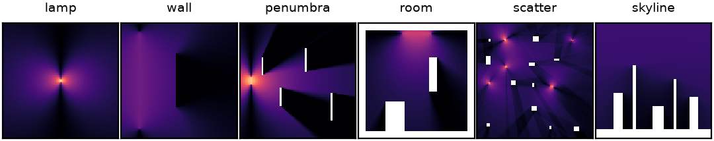
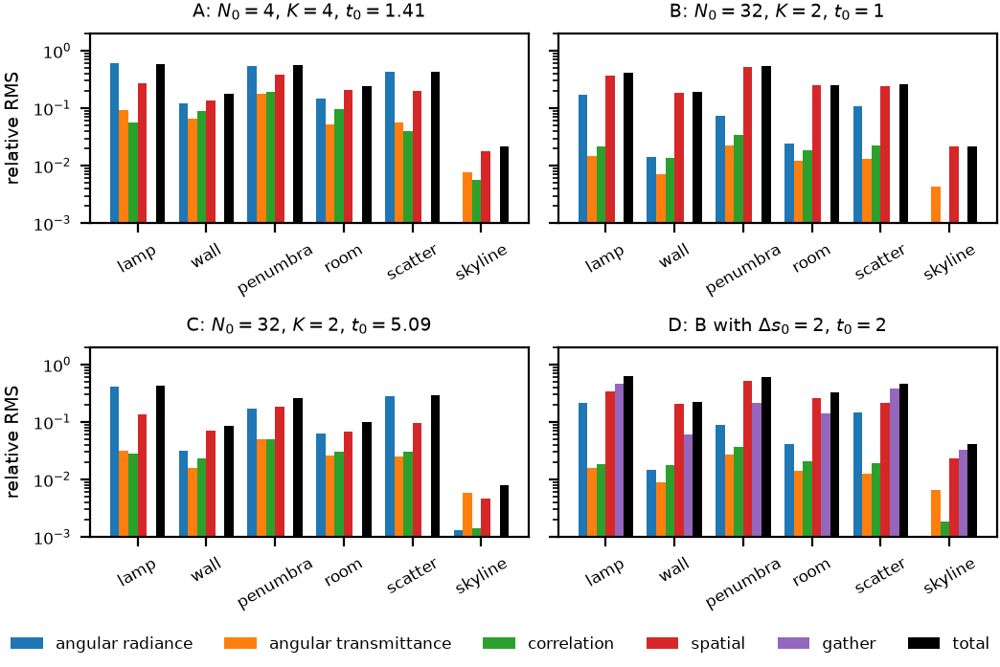
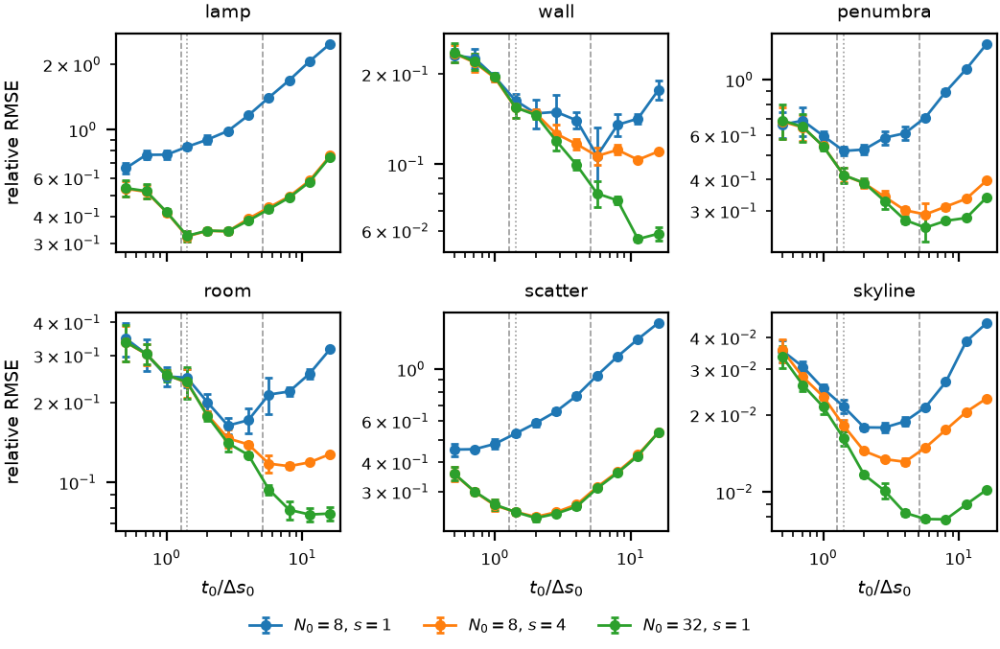
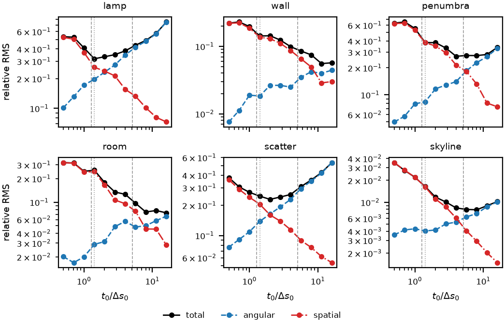
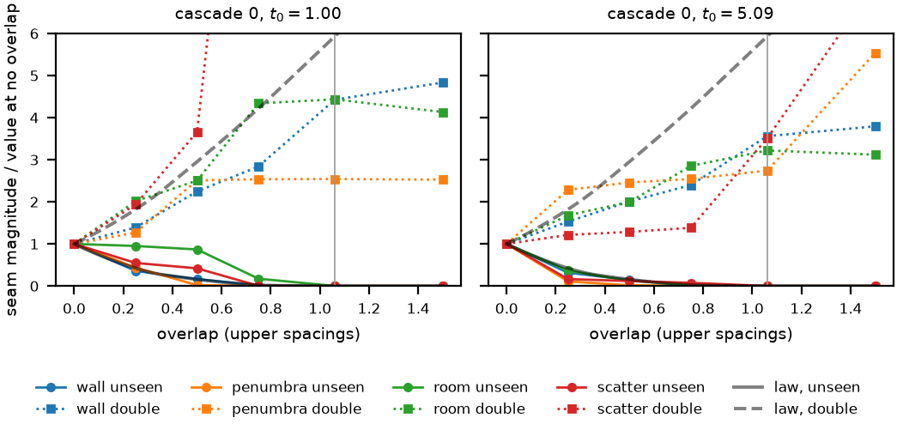
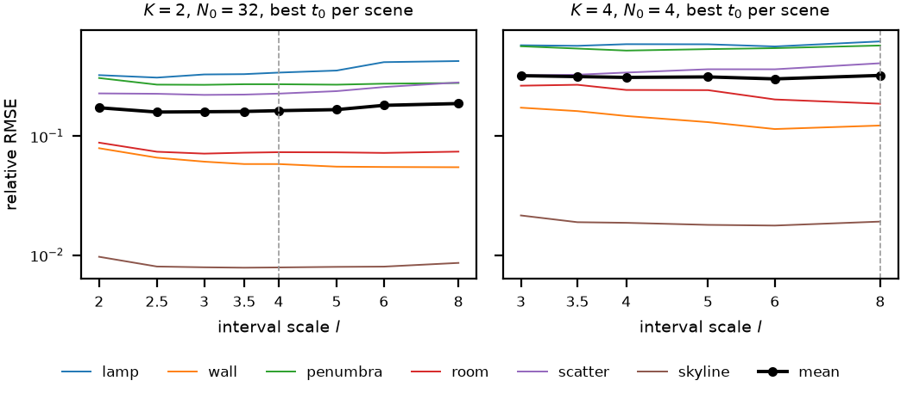
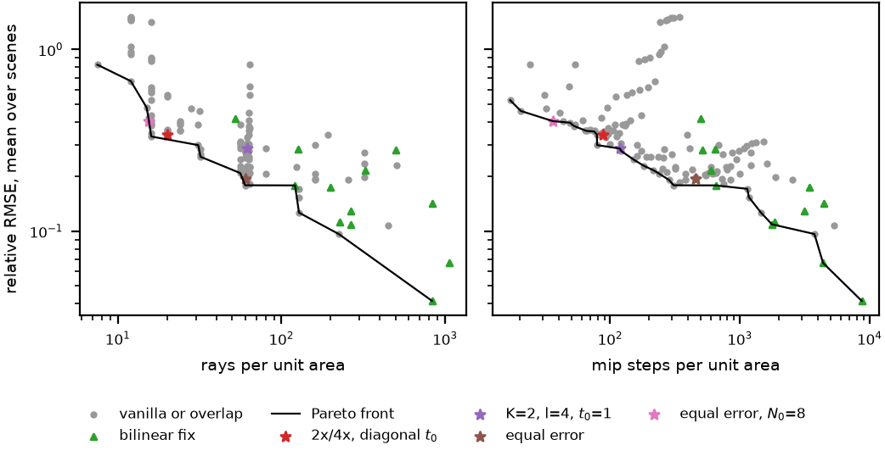
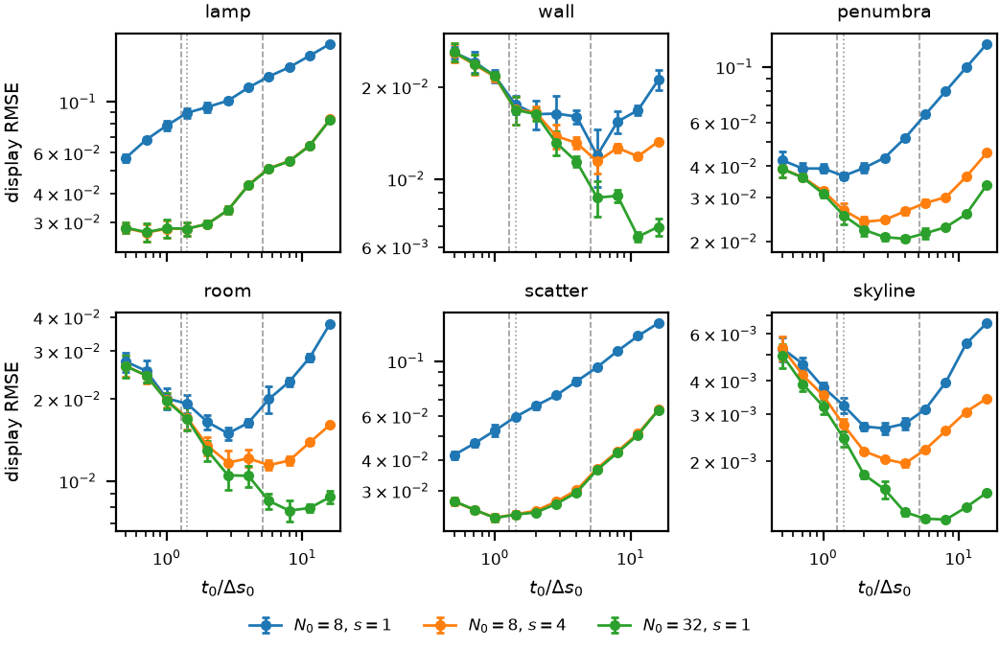

# Introduction {#sec:intro}

Radiance cascades compute global illumination from probe grids that see the scene at a resolution that falls with distance [@sannikov2023]. Near a probe, rays are dense in space and sparse in angle; far away, probes are sparse and directions dense. Each cascade traces only a short distance interval, $l$ times longer than the one below it, so a few cascades span a whole scene, and merging them from the top down assembles the light arriving from every distance. The method is used for real-time 2D lighting and has several 3D variants [@freeman2026split; @reservoircascades; @rcpg].

The quality of the result rests on six parameters: the cascade 0 probe spacing $\Delta s_0$, its direction count $N_0$, the branching factor $K$, the interval scale $l$, the cascade 0 interval $t_0$, and the rays per bin $s$. They are set by rules derived from asymptotic arguments, and the tests that exist disagree with the rules. The equal-error rule predicts $t_0 \approx 5\,\Delta s_0$ for 32 directions in 2D, yet $1\,\Delta s_0$ looked best [@freeman2026split]; a community sweep found an interval scale of 3 to 3.5 best by eye, where the rules ask for 2 or 4 [@rccommunity]. Each of these judgements was made by eye. No published work measures the error of radiance cascades against an exact answer across parameters, or traces the error to its causes.

This paper does both, in flatland, where exact answers are cheap. An exact reference gives the radiance of any distance interval, so every quantity radiance cascades estimate has a true value. That turns the error into a sum of parts with one cause each, and turns parameter rules into predictions that can be tested. The contributions, each marked as derived (with an assert-checked script) or measured (with a seeded experiment):

1. **An exact decomposition** of the error of radiance cascades into angular sampling of radiance and of transmittance, a cone-merge correlation, a spatial term from reading other probes, and the final gather, each carried to the image through the merges (derived, @sec:decomposition). The spatial term further splits into seams along each ray and parallax across it.
2. **Resolution against distance.** Under $l = 2K$ the gap between ray ends and the probe spacing keep a ratio of $t_0/(s\,t_{\mathrm{eq}})$ at every distance, so $t_0$ trades angular for spatial resolution everywhere at once (derived, @sec:profile).
3. **An aliasing law for small lights**, $\sqrt{f(1-f)}/x$ for a light spanning $x$ rays, and the distance $D_{\max} = (w s N_0/2\pi)^2/t_0$ out to which a light of width $w$ resolves (derived, @sec:aliasing). Probe errors follow the law to within 0.69 to 1.23 times, and image error collapses onto $D/D_{\max}$ (measured, @sec:smalllights).
4. **A seam law.** Without overlap, on cell-centred grids, 0.179 upper spacings of each ray are seen by neither cascade and as much by both; an overlap of $0.75\sqrt2 = 1.06$ upper spacings closes every gap, and overlap trades leaks for double counting at silhouettes (derived, @sec:seams; measured, @sec:fixes).
5. **The optimal cascade 0 interval** varies eightfold between scenes, from 0.3 to 2.5 times the equal-error value, at the balance of angular and spatial error that a simple model predicts. Rays per bin move it about as much as directions do, and the equal-error value is the robust choice, within 1.42 times every scene's optimal error (measured, @sec:t0).
6. **Where the error is and what fixes it.** At short intervals the spatial term dominates and over half of it comes from the first hand-over; the bilinear fix [@mytino2024; @osborne2024] at the equal-error interval gives the lowest error measured for each scene; along the measured Pareto front error falls about as the inverse square root of the rays, the rule settings lie within 1.15 times of the front except $t_0 = 1$ counted in rays, and the lowest errors need the bilinear fix with several rays per bin (measured, @sec:budget, @sec:fixes, @sec:pareto).

The rules under test come from the sources cited in @sec:rules; the merge, the bilinear fix and interval overlap are prior art. What is new here is the reference, the decomposition, the laws and the measurements.

# Background and related work {#sec:background}

## Radiance cascades {#sec:rc}

Radiance cascades [@sannikov2023] store radiance in a hierarchy of probe grids. Cascade $n$ places probes at spacing $\Delta s_n = 2^n \Delta s_0$, splits the circle of directions into $M_n = N_0 K^n$ equal bins of width $\Delta\omega_n = 2\pi/M_n$, and traces each bin over a distance interval. With interval scale $l$ and cascade 0 interval $t_0$, the hand-over distances are $t_n = t_0 l^n$, cascade $n$ traces $[t_{n-1}, t_n]$ with $t_{-1} = 0$, and the top cascade runs to infinity. @tbl:notation lists the symbols.

| Symbol | Meaning |
|---|---|
| $\Delta s_0$, $\Delta s_n = 2^n \Delta s_0$ | probe spacing of cascade 0 and of cascade $n$ |
| $N_0$, $K$ | directions of cascade 0, and the branching factor per cascade |
| $\Delta\omega_n = 2\pi/(N_0K^n)$ | angular bin width of cascade $n$ |
| $t_0$, $l$, $t_n = t_0 l^n$ | cascade 0 interval end, interval scale, hand-over distances |
| $s$ | rays per bin |
| $o$ | interval overlap, in upper probe spacings |
| $t_{\mathrm{eq}} = N_0\Delta s_0/2\pi$ | the equal-error cascade 0 interval in 2D |

: Notation. Lengths are in units of $\Delta s_0$ unless stated. {#tbl:notation}

Each bin $c$ of probe $p$ in cascade $n$ is estimated from $s$ rays. A ray returns the radiance of the first surface it meets inside the interval, or nothing, so the bin holds a mean radiance $\hat J_n(p,c)$ and a mean transmittance $\hat\beta_n(p,c)$. Merging runs from the top cascade down. Bin $c$ reads the $K$ child bins of the four upper probes $q$ around $p$, averages the children and blends the probes with bilinear weights $w_q(p)$:
$$
\hat X_n(p,c) = \sum_q w_q(p)\, \frac{1}{K} \sum_{c' \subset c} \hat R_{n+1}(q, c'), \qquad
\hat R_n(p,c) = \hat J_n(p,c) + \hat\beta_n(p,c)\, \hat X_n(p,c).
$$ {#eq:merge}
The top cascade has $\hat R = \hat J$. The fluence at a point $x$ is gathered from cascade 0:
$$
\hat F(x) = \sum_p w_p(x)\, \Delta\omega_0 \sum_c \hat R_0(p, c).
$$ {#eq:gather}
In flatland the fluence $F(x) = \int_0^{2\pi} L(x,\omega)\,d\omega$ plays the role of irradiance; it has no cosine factor.

The merge in @eq:merge is the vanilla merge. Around small bright sources it rings where cascades meet, because the upper probes see the source from other positions; in radiative transfer the worst case was an error just over 10% [@osborne2024]. The bilinear fix replaces the merge below the top cascade: for each child direction and each upper probe it traces one ray from the lower ray's start to the upper probe's interval end, merges that ray with the upper probe's bin, and blends the merged results [@mytino2024; @osborne2024]. Interval overlap extends each interval past the next cascade's start by $o\,\Delta s_{n+1}$; implementations use about $\sqrt 2$ upper spacings [@gmshaders].

## Parameter rules {#sec:rules}

The parameters are set by rules derived from asymptotic arguments, and the published record has no measured optimum for any of them.

- **Penumbra condition.** The original analysis grows the probe spacing in proportion to distance and shrinks the bin width in inverse proportion, which gives $l = 2$, $K = 2$ in 2D [@sannikov2023].
- **Equal error.** Split radiance cascades ask that the angular footprint at a ray's end equal the probe spacing in every cascade, $\Delta\omega_n t_n = \Delta s_n$ [@freeman2026split]. In 2D this needs $l = 2K$, and $K = 2$, $l = 4$ is the usual choice; at cascade 0 it gives $t_0 = t_{\mathrm{eq}} = N_0 \Delta s_0/2\pi$, which is $5.09\,\Delta s_0$ for 32 directions. Two other arguments, an alignment lemma for the bin shift under the merge [@reservoircascades] and a Nyquist bound on parallax for path guiding [@rcpg], select the same scaling.
- **Diagonal rule.** $t_0$ should be at least the diagonal of a cascade 0 cell, $\sqrt 2\,\Delta s_0$ in 2D; shorter intervals bend rays and leak [@rccommunity].
- **Light size.** A light resolves only if it is wider than the gap between neighbouring ray ends, $2\pi t_0/N_0$, and about twice that by the Nyquist limit [@rccommunity].

The evidence on these rules conflicts. The 2D test of split radiance cascades found $t_0 = 1\,\Delta s_0$ best by eye where equal error predicts $5\,\Delta s_0$, and explained it by aliasing looking worse than blur, adding that several rays per direction would favour a longer interval [@freeman2026split]. A community sweep of the interval scale found $\times 3$ and $\times 3.5$ best by eye [@rccommunity]. The one comparison against a reference image, made for holographic radiance cascades at equal time, found that radiance cascades had twice their RMSE, all of it in penumbras [@freeman2025hrc]; it neither swept parameters nor split the error by cause. Overlap is reported to fix leaks but not ringing [@rccommunity].

## Analysis of sampled light transport

Flatland has long served to study global illumination where exact answers are cheap: @heckbert1991 used it to develop adaptive radiosity meshing, and @jarosz2012 derived the 2D forms of the rendering equation and of common estimators. Frequency analysis predicts how blur and aliasing in light transport depend on distance and occluder geometry [@durand2005]. Radiance cascades sample a light field at a resolution that changes with distance, the question plenoptic sampling answers for image-based rendering [@chai2000]: how coarsely a light field can be sampled, given the depth range of the scene, before reconstruction aliases. Hierarchies of probes or volumes traded angular for spatial resolution before radiance cascades in cascaded light propagation volumes [@kaplanyan2010] and voxel cone tracing [@crassin2011], and probe-based methods such as DDGI interpolate irradiance from a sparse grid [@majercik2019].

# An exact flatland reference {#sec:reference}

A flatland scene is a set of line segments that meet only at shared endpoints. Each side of a segment emits a constant radiance, and rays that escape see a uniform sky. Radiance seen from a point is then piecewise constant in angle, and the radiance of any distance interval $[a, b]$ has an exact form.

To find it, each segment is clipped to the annulus $a \le |y - p| \le b$, which leaves at most two pieces per segment. The angles of all piece endpoints split the circle into cells. In each cell the nearest piece is the same for every direction, so one ray through the cell's middle angle, intersected with the pieces, gives the cell's radiance and whether it was blocked. The result is the exact interval radiance $L_{[a,b]}(p,\omega)$ and transmittance $\beta_{[a,b]}(p,\omega)$ as step functions of angle, from which bin means and fluence follow by exact integration.

The reference is checked against closed forms and against ray tracing (@sec:reproducibility): the fluence of a lone segment equals its radiance times its subtended angle; inside a closed emitter of radiance $c$ the fluence is $2\pi c$, and just outside a flat side it is $\pi c$; the profile matches traced rays at random angles exactly; and bin means match dense ray averages to sampling precision.

The radiance cascades under test use the same scenes. They trace rays analytically against the segments, so the only errors are the ones radiance cascades make: angular sampling, merging and interpolation.

# Decomposing the error {#sec:decomposition}

## Local error of one cascade

Write $R_n(p,c)$ for the exact mean, over bin $c$, of the radiance seen from $p$ beyond $t_{n-1}$: the value a perfect merge would hold. Write $\bar J$ and $\bar\beta$ for the exact bin means of the interval radiance and transmittance, and $\bar X$ for the exact bin mean of the radiance seen from $p$ beyond the interval's end. Merging cascade $n$ with an exact upper cascade gives $\tilde R_n = \hat J + \hat\beta\,\hat X[R_{n+1}]$, where $\hat X[\cdot]$ is the read of @eq:merge. Its error splits exactly into four parts:
$$
\tilde R_n - R_n =
\underbrace{(\hat J - \bar J)}_{\text{angular radiance}}
+ \underbrace{(\hat\beta - \bar\beta)\,\hat X}_{\text{angular transmittance}}
+ \underbrace{\bar\beta\,(\hat X - \bar X)}_{\text{spatial}}
+ \underbrace{\bar\beta\,\bar X - (R_n - \bar J)}_{\text{correlation}}.
$$ {#eq:local}
The identity holds because the four parts telescope. Each part has one cause:

- **Angular radiance and angular transmittance** are the error of estimating a bin mean from $s$ rays. They vanish as $s$ grows.
- **Spatial** is the error of reading the upper cascade at other probes. The upper probes sit up to $1.06$ upper spacings from $p$, so they see the far field from other points: this is merge parallax.
- **Correlation** is the error of multiplying bin means. $R_n - \bar J$ is the bin mean of $\beta$ times the far radiance, and the merge uses the product of the means, so the term is minus the covariance of transmittance and far radiance within the bin. It vanishes as bins narrow.

The angular radiance, angular transmittance and correlation terms all vanish as bins narrow or rays multiply, and together they form the angular error. The spatial term vanishes as probes move together.

## Carrying local errors to the image

The merge is linear in the upper cascade, so the full error of cascade $n$ is its local error plus the upper cascade's full error carried through one merge:
$$
\hat R_n - R_n = (\tilde R_n - R_n) + \hat\beta_n\,\hat X\big[\hat R_{n+1} - R_{n+1}\big].
$$ {#eq:carry}
Unrolling @eq:carry and applying @eq:gather gives the error of the image as a sum of each cascade's local terms, each carried down through the actual transmittances $\hat\beta$ of the cascades below it, plus one more term:
$$
\hat F(x) - F(x) = \sum_{m} \sum_{\text{terms}} \mathcal G\, \mathcal C_{0 \leftarrow m}\big[e_m^{\text{term}}\big] + \Big(\sum_p w_p(x) F(p) - F(x)\Big),
$$ {#eq:decomposition}
where $\mathcal C_{0 \leftarrow m}$ applies @eq:carry's second term $m$ times and $\mathcal G$ is the gather. The last term, the gather error, is what bilinear interpolation of exact probe fluence loses. The decomposition is exact: the parts sum to the error to rounding, which the self-test checks on random scenes.

## Seams and parallax {#sec:split}

The spatial term has two geometric causes. The offset $\delta = q - p$ from a lower probe to an upper probe has a component along each ray and one across it. Along the ray, the upper interval starts at $t_n$ from $q$, which lies at $t_n + \delta\cdot\omega$ along the lower ray, while the lower interval ends at $t_n + o\,\Delta s_{n+1}$. Where $\delta\cdot\omega > o\,\Delta s_{n+1}$ a stretch of the ray is seen by neither cascade, and where it is smaller a stretch is seen by both. Across the ray, the upper probe sees the far field from a shifted origin.

To separate the two, the upper read is replaced by one that starts at the point of $q$'s ray level with the lower interval's end, $q + (t_n + o\,\Delta s_{n+1} - \delta\cdot\omega)\,\omega$. The difference between the actual and the matched read is the seam part, split by the sign of $\delta\cdot\omega - o\,\Delta s_{n+1}$ into an unseen and a double-seen part; what remains, the matched read against the exact far field from $p$, is the parallax part. The three parts sum to the spatial term exactly in the limit of many rays; with 16 rays per upper bin the self-test matches them to sampling precision.

# Theory {#sec:theory}

## Resolution against distance {#sec:profile}

At distance $D$ a cascade sees with two resolutions: the gap between neighbouring ray ends, $g = D\,\Delta\omega_n/s$, and the probe spacing $\Delta s_n$, where $n$ is the cascade that holds $D$. At the end of cascade $n$'s interval,
$$
\frac{g}{\Delta s_n} = \frac{t_0 l^n\, 2\pi}{s\, N_0 K^n\, 2^n \Delta s_0} = \frac{t_0}{s\,t_{\mathrm{eq}}}\left(\frac{l}{2K}\right)^{n}.
$$ {#eq:ratio}
The ratio is the same in every cascade only when $l = 2K$, which is the equal-error scaling. Under $K = 2$, $l = 4$, writing $2^n = \sqrt{D/t_0}$ at the interval ends gives both resolutions as functions of distance:
$$
g(D) = \frac{2\pi}{s N_0}\sqrt{D\,t_0}, \qquad \Delta s(D) = \Delta s_0 \sqrt{D/t_0}.
$$ {#eq:profile}
Both grow as $\sqrt D$, and $t_0$ moves error from one to the other at every distance: a longer cascade 0 interval keeps each distance in a lower cascade, with finer probes and coarser bins. Sweeping $t_0$ at fixed $N_0$, $K$ and $l$ therefore also changes the angular resolution of the far field. At $N_0 = 32$, a scene $181\,\Delta s_0$ across is spanned by five cascades at $t_0 = 1$, whose top cascade has 512 directions, and by three at $t_0 = 16$, whose top cascade has 128. Within a cascade, $g$ grows linearly with $D$ from $1/l$ of its end value, so @eq:profile is the envelope at the interval ends.

The equal-error rule $t_0 = t_{\mathrm{eq}}$ makes the two resolutions equal. Nothing in the rule says the two kinds of error cost the same, and the experiments in @sec:t0 show they do not.

## Aliasing of small lights {#sec:aliasing}

A light that subtends angle $\alpha$ from a probe spans $x = \alpha s/\Delta\omega_n$ ray spacings. At a phase against the rays that is uniform over probes, $\lfloor x \rfloor$ or $\lceil x \rceil$ rays hit it, the second with probability $f = x - \lfloor x \rfloor$. The estimate is the hit count over $x$ times the truth, so its relative error has RMS
$$
\epsilon(x) = \frac{\sqrt{f(1-f)}}{x} \le \frac{1}{2x},
$$ {#eq:aliasing}
and over a spread of $x$ the mean of $f(1-f)$ is $1/6$, so the typical error is $1/(\sqrt 6\, x) \approx 0.41/x$. A light one ray gap wide errs by up to 50%, a light two gaps wide, the Nyquist width, by up to 25%, and an error below 10% needs five gaps.

Combining @eq:aliasing with @eq:profile under $K = 2$, $l = 4$: a light of width $w$, seen face on, spans at least one ray gap out to the resolvable distance
$$
D_{\max} = \frac{1}{t_0}\left(\frac{w\, s\, N_0}{2\pi}\right)^{2}.
$$ {#eq:dmax}
It is quadratic in $N_0$ and in $s$ and inverse in $t_0$. A light two spacings wide at $N_0 = 32$ resolves to $104\,\Delta s_0$ at $t_0 = 1$ and to $20\,\Delta s_0$ at $t_0 = t_{\mathrm{eq}}$. Beyond $D_{\max}$ the relative error grows as $\sqrt{D/D_{\max}}$. The light-size rule of @sec:rules is the special case $D = t_0$. Holographic radiance cascades size their sampling the same way, with at least $2\pi a$ rays at distance $a$ so that no feature of unit size is missed [@freeman2025hrc]; @eq:aliasing gives the error when a light spans fewer.

## Seams {#sec:seams}

On cell-centred grids with spacing doubling per cascade, a lower probe sits at a quarter of its upper cell on each axis. Its four upper probes lie at $0.35$, $0.79$, $0.79$ and $1.06$ upper spacings with bilinear weights $9/16$, $3/16$, $3/16$ and $1/16$. Over uniform directions the mean of $\max(\delta\cdot\omega - o, 0)$ is $|\delta|/\pi$ at $o = 0$, so the mean unseen length is
$$
\bar u(0) = \frac{1}{\pi}\sum_q w_q |\delta_q| = \frac{0.562}{\pi} = 0.179 \text{ upper spacings}.
$$ {#eq:seam}
Every gap closes at $o = 0.75\sqrt 2 = 1.06$ upper spacings, the distance to the farthest upper probe; $o = 0.5$ leaves 16% of the gap. Because $\delta\cdot\omega$ averages to zero over directions, the mean double-seen length is $\bar u(o) + o$: equal to the unseen length without overlap, and growing one for one with overlap.

The two seams err in different ways. A surface in an unseen stretch is missed, and light from behind it leaks through. A surface in a double-seen stretch is counted by the lower ray and again by the upper read; when the lower ray is blocked its transmittance removes the upper read, so the double count survives only where a bin is partly covered. For a bin a fraction $c$ covered by a surface of radiance $L_S$ in front of a background $L_B$, the merge of means gives $(1-c)\,(cL_S + (1-c)L_B)$ where the truth is $(1-c)L_B$, an error of $c(1-c)(L_S - L_B)$. Overlap therefore trades leaks through thin occluders for double counting at the silhouettes of objects in the overlap zone, which is largest for small bright lights.

## The optimal cascade 0 interval {#sec:balance}

@eq:profile gives a model of how the error depends on $t_0$. Suppose the squared error at distance $D$ is $A(D)\,g^2 + B(D)\,\Delta s^2$, with weights set by the scene: $A$ by how much small or sharp radiance there is to alias, $B$ by how much occluder edges and gradients there are to blur. Summed over distance, under $K=2$, $l=4$,
$$
E^2(t_0) = \bar A\,\frac{t_0}{t_{\mathrm{eq}}} + \bar B\,\frac{t_{\mathrm{eq}}}{t_0},
\qquad
t_0^\ast = t_{\mathrm{eq}} \sqrt{\bar B/\bar A},
$$ {#eq:balance}
and at $t_0^\ast$ the two parts are equal. Equal error is optimal only for a scene that weights the two blurs alike. The model predicts that $t_0^\ast$ scales with $N_0$ for a fixed scene, through $t_{\mathrm{eq}}$, and that $t_0^\ast$ sits where the angular and spatial errors cross. If the two errors grow as other powers, $E^2 = a t_0^{\alpha} + b t_0^{-\beta}$, the optimum lies at $(\beta/\alpha)^{1/(\alpha+\beta)}$ times the crossing: aliasing ($\alpha = 1$) against a blurred step edge, whose squared error grows with the blur width ($\beta = 1/2$), puts it at $0.63$ times the crossing.

Rays per bin enter @eq:balance through $g$: $s$ rays cut the aliasing weight by $s^2$ and move the optimum up by $s$, as long as aliasing rather than bin-mean blur dominates the angular error. An experiment can tell the two apart: $N_0 = 8$ with $s = 4$ has the rays of $N_0 = 32$ with the bins of $N_0 = 8$.

# Experiments {#sec:experiments}

## Setup {#sec:setup}

Six scenes on a window $128\,\Delta s_0$ wide cover the cases the rules disagree on (@fig:scenes): *lamp*, a light two spacings long in empty space; *wall*, a long light and a thin occluding wall; *penumbra*, a small bright light and thin occluders at several distances; *room*, a closed room lit by a ceiling lamp, with two blocks; *scatter*, five small lights and eight boxes; and *skyline*, blocks on the ground under a uniform sky. Coordinates avoid multiples of the probe spacings, so no probe centre falls on a segment.

{#fig:scenes width=100%}

Pixels are the centres of the $128^2$ grid outside solids. Cascade 0 has one probe per pixel, $\Delta s_0 = 1$, unless stated; then probes sit on pixel centres and the gather error is zero. The number of cascades is the fewest for which the top cascade, had it ended at $t_0 l^{N-1}$, would reach the window's diagonal; it runs to infinity instead. Error depends on where the scene sits against the probe grids, so every number is a mean over the scene moved by six random whole-spacing offsets in $[0, 32)^2$, which vary the alignment of every cascade, and error bars show the spread.

Two metrics are reported. The primary one is the relative RMSE of fluence, $\lVert \hat F - F\rVert_2 / (\sqrt{P}\,\bar F)$ over the $P$ pixels, the quantity @eq:decomposition splits. The display RMSE applies a Reinhard tone map $y = x/(1+x)$ to both images after scaling the mean fluence to 0.18, so a bright light's own error counts less. Neither metric measures how visible an error is; @sec:limitations returns to this.

Cost is counted per unit area of the window in three ways: rays; ray steps at a fixed step of $\Delta s_0$; and ray steps at each cascade's own spacing, the cost of a tracer that marches cascade $n$ through a mip level of spacing $\Delta s_n$. The top cascade is counted to the window's diagonal. The bilinear fix traces $4K$ rays per bin below the top cascade.

## Where the error is {#sec:budget}

@fig:budget splits the error of four settings into the terms of @eq:decomposition: A, the 2D scheme most implementations use, with four directions branching by four and the diagonal rule's $t_0$; B, the setting of the 2D test of split radiance cascades; C, the same at the equal-error $t_0$; and D, setting B with cascade 0 at half the pixel resolution. @tbl:budget in the appendix lists the numbers.

{#fig:budget width=100%}

Which term dominates depends on the setting more than on the scene. In setting B the spatial term is the largest in every scene, 0.19 to 0.52 of the mean fluence against at most 0.17 for angular radiance; the teaser figure shows it in the room as bands where cascades meet. With four directions (A), sampling the radiance of small lights dominates instead: the angular radiance term reaches 0.61 in the lamp, 0.54 in penumbra and 0.43 in scatter. At the equal-error $t_0$ (C) the spatial term falls 2.4 to 4.4 times from setting B, and the angular radiance term rises 2.2 to 2.7 times, so the small-light scenes, lamp and scatter, end up dominated by angular error and the others balanced. Angular transmittance and correlation stay at or below 0.05 at 32 directions. Halving cascade 0's resolution (D) makes the gather term, the interpolation of probe fluence to pixels, the largest term near small lights: 0.47 in the lamp and 0.38 in scatter.

Most of the spatial error comes from the first hand-over. Averaged over scenes, the merge of cascade 0 with cascade 1 holds 52 to 64% of the squared spatial term in every setting, and the next merge 27 to 30%. The angular error is spread over cascades.

## The cascade 0 interval {#sec:t0}

@fig:t0 sweeps $t_0$ from 0.5 to 16 spacings at $K = 2$, $l = 4$ for three samplings, and @tbl:t0 lists the optimum of each curve, from a parabola in $\log t_0$ through the best point and its neighbours.

{#fig:t0 width=100%}

| Scene | $N_0=8$, $s=1$ | $N_0=8$, $s=4$ | $N_0=32$, $s=1$ | Crossing, $N_0=32$ | $t_0^\ast/t_{\mathrm{eq}}$, $N_0=32$ |
|---|---|---|---|---|---|
| lamp | $\le 0.5$ | 1.58 | 1.59 | 2.06 | 0.31 |
| wall | 5.73 | 11.49 | 12.95 | 8.97 | 2.54 |
| penumbra | 1.64 | 5.35 | 5.71 | 5.59 | 1.12 |
| room | 3.16 | 7.71 | 12.69 | 7.54 | 2.49 |
| scatter | $\le 0.5$ | 2.01 | 2.06 | 1.96 | 0.40 |
| skyline | 2.40 | 3.54 | 6.77 | 4.33 | 1.33 |

: Error-optimal $t_0$ in cascade 0 spacings, the $t_0$ where the angular and spatial terms cross, and the optimum over the equal-error value. {#tbl:t0}

**The optimum depends on the scene.** At 32 directions it lies at 0.31 and 0.40 times $t_{\mathrm{eq}}$ for the two scenes made of small lights, lamp and scatter; at 1.1 to 1.3 times for penumbra and skyline; and at 2.5 times for wall and room, which are lit by large emitters and whose error sits in shadows. The optima span a factor of 8. The small-light scenes reproduce the 2D test that found $t_0 = 1$ best at 32 directions [@freeman2026split]: their optima are 1.6 and 2.1 spacings, and the equal-error $t_0$ costs them 1.3 times the optimal error. The same short interval costs the other scenes 2.1 to 3.5 times their optimal error.

**The balance model predicts the optimum.** In @fig:balance the angular terms grow with $t_0$ at log-log slopes of $+0.28$ to $+0.55$, against the $+0.5$ of @eq:profile. The spatial term falls at slopes of $-0.56$ to $-0.94$: near $-0.5$ where it is a blur whose width follows the spacing, and near $-1$ in the smooth skyline, where linear interpolation errs by the square of the spacing. With exponents this close, @eq:balance puts the optimum near the crossing, and the measured optima lie at 0.77 to 1.68 times it. From 8 to 32 directions the optimum grows 2.3 to 4.0 times, and at least 3.2 and 4.1 times in lamp and scatter, whose optima at 8 directions lie below the sweep; the model, through $t_{\mathrm{eq}}$, predicts 4.

{#fig:balance width=100%}

**Rays, not bins, set the optimum.** Eight directions with four rays per bin have the rays of 32 directions and the bins of 8. They reach the optimum of 32 directions to within 3% in lamp and scatter, 1.58 against 1.59 spacings in the lamp, with an error curve that matches it at every $t_0$, and to within 6% in penumbra. Their angular error is therefore aliasing between rays, which more rays per bin remove as well as more bins do, as split radiance cascades anticipated [@freeman2026split]. In wall, room and skyline the curves part at long intervals, and the optimum stays below that of 32 directions, at 0.5 to 0.9 times: there the mean over a wide bin, a blur, adds to the angular error. The equal-error rule has no term for rays per bin, yet going from one to four rays at 8 directions moves the optimum 3.3 times in penumbra and at least 3.2 and 4.0 times in lamp and scatter, close to the factor of 4 that @sec:balance predicts when aliasing sets the angular error, and 1.5 to 2.4 times in the others.

**Equal error is the robust choice.** No single $t_0$ suits every scene, but one can limit the worst case. At 32 directions, $t_0 = 5.66$, the grid point nearest $t_{\mathrm{eq}}$, keeps every scene within 1.42 times its optimal error; $t_0 = 1$ allows 3.5 times. The same minimax choice is 2 spacings at 8 directions, 1.6 $t_{\mathrm{eq}}$, and 4 spacings at 8 directions with four rays per bin. By the display metric (@fig:display in the appendix) the optima are lower, by up to 2.2 times in the small-light scenes, and the minimax $t_0$ at 32 directions is 4 spacings, within 1.76 times every optimum.

## Small lights {#sec:smalllights}

@fig:resolution tests @eq:aliasing and @eq:dmax. At the probes (left), for lights 0.5 to 8 spacings wide, at $t_0 = 1$ and $5.09$, and with one or four rays per bin, the relative error of each probe's interval fluence follows the aliasing law: binned by the number of rays the light spans, the measured RMS lies at 0.69 to 1.23 times the prediction in every bin with at least 30 probes. All cases fall on one curve, so the light's width, the interval and the ray count act only through $x$.

{#fig:resolution width=100%}

In the image (right), the error of twelve lamps, three widths at two direction counts and two intervals, collapses when distance is measured in units of $D_{\max}$. Beyond $0.3\,D_{\max}$ a single power law, $0.32\,(D/D_{\max})^{0.42}$, fits all 84 distance bands to within a factor of 1.32, close to the $\sqrt{D/D_{\max}}$ of @sec:aliasing. Closer to the lamps the error levels off at 0.1 to 0.3, the ringing of the spatial term. The resolvable distance thus predicts where a small light starts to alias, and @eq:dmax says what moves it: it grows with the square of the directions and of the rays per bin, and falls in proportion to $t_0$.

## Seams and fixes {#sec:fixes}

@fig:seams measures the seam parts of the spatial term at cascade 0 against overlap. Without overlap, the unseen part is smaller than the parallax part in every scene and at both intervals: 1.9 to 2.2 times smaller in wall, 3.7 to 6.5 times in room and penumbra, and over 40 times in scatter, and the double-seen part is smaller still. Most of the spatial error is parallax, not seams. At $t_0 = 5.09$ the unseen part falls with overlap as @eq:seam predicts in all four scenes and vanishes at 1.06 upper spacings. At $t_0 = 1$ it falls more slowly in room and scatter, where the gap is as long as cascade 0's whole interval. The double-seen part grows 2.5 to 4.4 times by 1.06 upper spacings, and far more in scatter at $t_0 = 1$, whose small lights the overlap zone counts twice.

{#fig:seams width=100%}

@tbl:fixes compares the fixes. Overlap of 1.06 upper spacings cuts the error of wall and room 2.0 to 3.3 times, since it closes the gaps through which light leaks past thin walls, and it raises the error of lamp and scatter by up to 1.8 times through double counting: the trade that @sec:seams derives. The community's finding that overlap fixes leaks but not ringing [@rccommunity] is this trade measured. The bilinear fix lowers the error everywhere except in skyline at $t_0 = 1$. At the equal-error $t_0$ it gives the lowest error in the table for all six scenes, 3.3 times below vanilla in the lamp and 5.7 times in wall, at about 7.5 times the rays and 7.2 times the mip steps.

| Scene | vanilla | overlap 0.5 | overlap 1.06 | bilinear fix | vanilla | overlap 0.5 | overlap 1.06 | bilinear fix |
|------|----|----|----|----|------|----|----|----|
| | $t_0=1$ | | | | $t_0=5.09$ | | | |
| lamp | 0.418 | 0.413 | 0.650 | 0.198 | 0.423 | 0.435 | 0.494 | **0.127** |
| wall | 0.196 | 0.069 | 0.060 | 0.062 | 0.085 | 0.039 | 0.027 | **0.015** |
| penumbra | 0.543 | 0.300 | 0.430 | 0.262 | 0.258 | 0.190 | 0.206 | **0.087** |
| room | 0.253 | 0.128 | 0.119 | 0.138 | 0.099 | 0.049 | 0.049 | **0.028** |
| scatter | 0.264 | 0.307 | 0.475 | 0.160 | 0.291 | 0.309 | 0.356 | **0.119** |
| skyline | 0.021 | 0.026 | 0.030 | 0.025 | 0.008 | 0.008 | 0.009 | **0.006** |
| mip steps | 1 | 1.51 | 2.07 | 7.14 | 1 | 1.12 | 1.26 | 7.24 |

: Relative RMSE of the fixes at $N_0 = 32$, $K = 2$, $l = 4$, and their cost in mip steps relative to vanilla. Overlap is in upper probe spacings. {#tbl:fixes}

Overlap is cheap at the equal-error $t_0$, 12 to 26% more mip steps, but costs 51 to 107% at $t_0 = 1$, where 1.06 upper spacings is twice the cascade 0 interval. Whether the bilinear fix beats spending its rays on more directions is the subject of @sec:pareto.

## Interval scale and cost {#sec:pareto}

@fig:lsweep varies the interval scale at each scene's best $t_0$. With $K = 2$, scales from 2.5 to 4 come within 3% of each other in mean error; $l = 2$ is 9% worse and $l = 8$ 18% worse. The scales of 3 to 3.5 that a by-eye sweep preferred [@rccommunity] sit in this shallow minimum, and so does the equal-error $l = 4$. With four directions branching by four, the scale changes the mean error by at most 7% between 3 and 8. Once $t_0$ is tuned, the interval scale matters little.

{#fig:lsweep width=100%}

@fig:pareto places all 122 measured settings by cost and by mean error over the scenes: the interval-scale sweep, the rule settings, and 48 random settings of $K$, $l$, $N_0$, $t_0$, $s$, overlap and merge. The rule settings lie close to the Pareto front. Equal error at 8 directions sits on it, the 2x/4x scheme with the diagonal $t_0$ within 1.03 times by rays and 1.15 by mip steps, and equal error at 32 directions within 1.08 times by either cost. $t_0 = 1$ at 32 directions lies on the front by mip steps, because a short cascade 0 interval is cheap to march, but 1.59 times above it by rays. Along the front the error falls about as the inverse square root of the rays, from 0.33 at 16 rays per unit area to 0.041 at 832. The two lowest errors measured, 0.067 and 0.041, both use the bilinear fix with two or four rays per bin; at moderate error the front's settings spend their rays on directions and rays per bin instead.

{#fig:pareto width=100%}

| $K$ | $l$ | $N_0$ | $t_0$ | $s$ | Fix | Rays | Mip steps | Front | Relative RMSE |
|--|--|--|---|--|-----|---|---|----|----|
| 4 | 8 | 4 | 0.5 | 1 |  | 16 | 112 | rays | 0.332 |
| 2 | 4 | 8 | 1.27 | 1 |  | 16 | 36 | both | 0.403 |
| 4 | 6 | 4 | 1 | 2 |  | 32 | 233 | rays | 0.257 |
| 2 | 6 | 32 | 1.41 | 1 | overlap 0.5 | 60 | 308 | both | 0.179 |
| 4 | 4 | 16 | 5.66 | 2 | overlap 0.5 | 128 | 1454 | both | 0.127 |
| 2 | 8 | 64 | 8 | 2 |  | 224 | 3752 | both | 0.097 |
| 4 | 3 | 16 | 2.83 | 2 | bilinear fix | 1056 | 4373 | mip steps | 0.067 |
| 4 | 4 | 16 | 5.66 | 4 | bilinear fix | 832 | 8689 | both | 0.041 |

: Selected settings on the Pareto front by rays, by mip steps or both, with their costs per unit area. The second row is the equal-error rule at 8 directions. {#tbl:pareto}

# Discussion {#sec:discussion}

**Choosing parameters.** The measurements turn the rules into a procedure. The equal-error $t_0$ is the safe default: it is the minimax choice, within 1.42 times every scene's optimal error at 32 directions. From there, a scene lit by small sources wants a shorter interval, down to about $0.3\,t_{\mathrm{eq}}$, and a scene lit by large emitters, whose visible error sits in shadows, wants a longer one, up to about $2.5\,t_{\mathrm{eq}}$. Small lights are also served by rays per bin: four rays at 8 directions matched 32 directions in the small-light scenes while storing a quarter of the bins, though they did not match 32 directions where the error is in shadows. @eq:dmax sizes the sampling for a target light: an error below about 10% needs the light to span five ray gaps, so $sN_0 \ge 10\pi\sqrt{D t_0}/w$ at the farthest distance $D$ it must be seen from.

**Seams and parallax.** Most of the spatial error is parallax, not seams, so overlap cannot remove it; overlap closes the gaps, which matters where thin occluders leak, and costs double counting at small bright lights. When overlap is used, 1.06 upper spacings closes every gap on cell-centred 2D grids, three quarters of the $\sqrt 2$ upper spacings in use [@gmshaders]. The bilinear fix removes parallax at the probes it reads and gives the lowest error measured, but at about 7.5 times the rays. On the measured front it pays off only at the low-error end: the two lowest errors use it, while at moderate error the same rays do more as directions and rays per bin.

**Three dimensions.** The analysis carries over in structure. In 3D with $K = 4$ and $l = 4$ a bin's angular width halves per cascade while the spacing doubles, so both resolutions grow as $\sqrt D$ and $t_0$ trades one for the other as in @eq:profile; the equal-error interval is $\Delta s_0\sqrt{N_0/4\pi}$, 1.60 spacings at 32 directions (derived). With $s$ rays spread over each cell the ray gap is $t\,\Delta\omega/\sqrt s$, so a light of width $w$ spans one gap out to $D_{\max} = w^2 s N_0/(4\pi t_0)$, linear rather than quadratic in $N_0$: for a light two spacings wide at 32 directions and the equal-error interval, 6.4 spacings (derived). With trilinear reads from cell-centred grids the mean unseen seam is $0.177$ upper spacings and an overlap of $0.75\sqrt3 = 1.30$ upper spacings closes every gap, against the $\sqrt 3$ of the diagonal (derived). The aliasing law changes form, because a light's outline on the sphere crosses many ray cells: we conjecture that the hit count of a light spanning $x$ cells fluctuates with its perimeter, as lattice-point counts do, so its relative error falls as $x^{-3/4}$ rather than $x^{-1}$. Whether the optimal $t_0$ spreads as widely across 3D scenes, and where it sits against the diagonal rule, needs a 3D reference.

# Limitations {#sec:limitations}

The scenes are flatland and emit and absorb only: there is no reflection, so no indirect light, and fluence stands in for irradiance without a cosine. Six scenes on one window cover the cases the rules disagree on, small lights, large emitters and occluders, but the optima are those of these scenes. The tracer is exact; implementations that march voxels, distance fields or depth buffers add errors of their own, and their cost is time on a GPU, which the ray and step counts only approximate. Ray directions are fixed and stratified; jitter and temporal accumulation turn aliasing into noise, which the metrics here would count differently. Both metrics are RMSE. Neither measures how visible an error is, so the claim that aliasing looks worse than blur [@freeman2026split] is neither confirmed nor refuted here; what is shown is that the optimum moves with the scene by RMSE alone. The Pareto front comes from 122 settings, a sparse sample of a seven-dimensional space.

# Conclusion {#sec:conclusion}

Against an exact reference, the error of radiance cascades splits into parts with one cause each, and simple laws predict those parts: the cascade 0 interval trades angular for spatial resolution at every distance, small lights alias as the number of rays they span, and seams follow from the geometry of the probe grids. The measurements explain the conflicting tests of the parameter rules: the optimal interval depends on whether a scene's light comes from small sources or large ones, the equal-error rule is the best compromise rather than the optimum, and rays per bin move the optimum as much as directions do. The same reference, extended to three dimensions and to bounced light, can settle the questions this paper leaves open.

# Acknowledgments {.unnumbered}

The derivations, experiments and drafting of this paper were carried out with Claude, a large language model by Anthropic, working under the author's direction.

# Further results {#sec:further .appendix}

@tbl:budget lists the error terms of @fig:budget, and @fig:display repeats @fig:t0 with the display metric.

| Setting | Scene | angular radiance | angular transmittance | correlation | spatial | gather | total |
|---|----|----|-----|----|---|---|---|
| A | lamp | 0.608 | 0.091 | 0.057 | 0.273 | 0.000 | 0.591 |
| A | wall | 0.121 | 0.066 | 0.089 | 0.138 | 0.000 | 0.178 |
| A | penumbra | 0.536 | 0.182 | 0.195 | 0.384 | 0.000 | 0.568 |
| A | room | 0.148 | 0.053 | 0.095 | 0.211 | 0.000 | 0.242 |
| A | scatter | 0.428 | 0.056 | 0.040 | 0.204 | 0.000 | 0.433 |
| A | skyline | 0.000 | 0.008 | 0.006 | 0.018 | 0.000 | 0.022 |
| B | lamp | 0.173 | 0.015 | 0.021 | 0.370 | 0.000 | 0.418 |
| B | wall | 0.014 | 0.007 | 0.014 | 0.185 | 0.000 | 0.196 |
| B | penumbra | 0.074 | 0.023 | 0.034 | 0.524 | 0.000 | 0.543 |
| B | room | 0.024 | 0.012 | 0.018 | 0.249 | 0.000 | 0.253 |
| B | scatter | 0.107 | 0.013 | 0.023 | 0.239 | 0.000 | 0.264 |
| B | skyline | 0.001 | 0.004 | 0.001 | 0.022 | 0.000 | 0.021 |
| C | lamp | 0.409 | 0.032 | 0.028 | 0.134 | 0.000 | 0.423 |
| C | wall | 0.031 | 0.016 | 0.023 | 0.071 | 0.000 | 0.085 |
| C | penumbra | 0.168 | 0.050 | 0.050 | 0.188 | 0.000 | 0.258 |
| C | room | 0.064 | 0.027 | 0.030 | 0.068 | 0.000 | 0.099 |
| C | scatter | 0.280 | 0.025 | 0.031 | 0.098 | 0.000 | 0.291 |
| C | skyline | 0.001 | 0.006 | 0.001 | 0.005 | 0.000 | 0.008 |
| D | lamp | 0.218 | 0.016 | 0.019 | 0.346 | 0.466 | 0.620 |
| D | wall | 0.015 | 0.009 | 0.018 | 0.208 | 0.061 | 0.225 |
| D | penumbra | 0.089 | 0.027 | 0.037 | 0.527 | 0.215 | 0.600 |
| D | room | 0.042 | 0.014 | 0.021 | 0.260 | 0.142 | 0.327 |
| D | scatter | 0.145 | 0.012 | 0.019 | 0.216 | 0.383 | 0.456 |
| D | skyline | 0.001 | 0.007 | 0.002 | 0.023 | 0.033 | 0.041 |

: Error terms of @fig:budget: RMS over the pixels relative to the mean exact fluence, mean over six grid offsets. {#tbl:budget}

{#fig:display width=100%}

# Reproducibility {#sec:reproducibility .appendix}

The lab, the checks and the experiments are plain Python with NumPy; figures use Matplotlib. The lab's tracer and reference run on a GPU through CuPy when it is installed, and on the CPU otherwise, with the same results to rounding. Each derived number in the text has an assert-based check script, and each measured number comes from a seeded experiment script that regenerates its figure and prints its table:

| Script | Content |
|---|---|
| `lab/selftest.py` | the reference against closed forms and ray tracing; the decomposition identity; the seam and parallax split |
| `checks/resolution_profile.py` | @eq:ratio, @eq:profile, @eq:dmax, the optimum of @eq:balance, and the 3D equal-error interval and resolvable distance |
| `checks/aliasing_law.py` | @eq:aliasing, its mean and its bounds |
| `checks/seam_gap.py` | @eq:seam, the closing overlap and the double-seen length |
| `experiments/budget.py` | the teaser, @fig:scenes, @fig:budget, @tbl:budget |
| `experiments/t0_sweep.py` | @fig:t0, @fig:balance, @fig:display, @tbl:t0 |
| `experiments/resolution.py` | @fig:resolution |
| `experiments/seams.py` | @fig:seams, @tbl:fixes |
| `experiments/parameters.py` | @fig:lsweep, @fig:pareto, @tbl:pareto |

: Scripts behind each result. Paths are relative to the paper's directory, except the lab. {#tbl:scripts}
