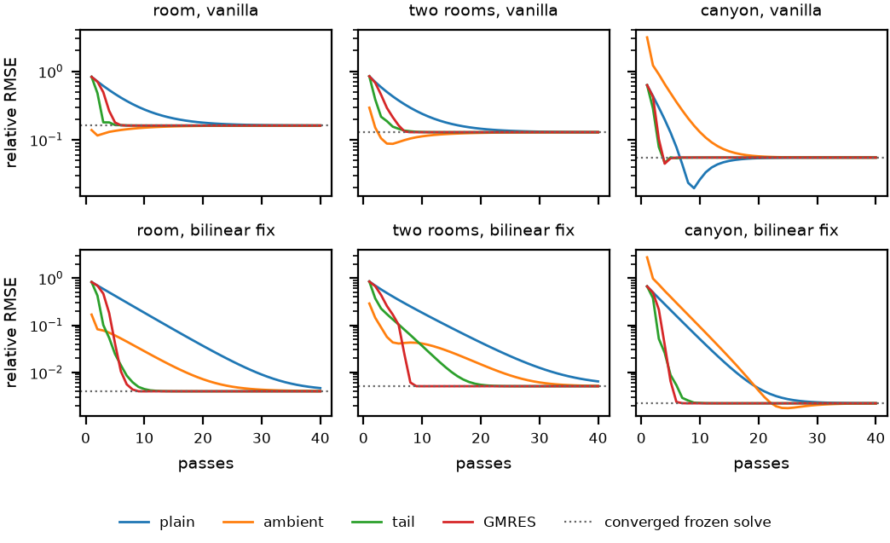

# Introduction {#sec:intro}

Radiance cascades (RC) compute the light arriving at every point of a scene from the light its surfaces send out [@sannikov2023]. One solve therefore gives one bounce. Most implementations get more bounces by feeding the last frame's result back as emission, which applies one more bounce per frame: a Jacobi iteration spread over frames, which lags behind moving lights and opening doors. Within one frame the options are one bounce plus a constant ambient term, or a second full solve per extra bounce [@freeman2025hrc]. Practitioners have pointed out that stored ray hits would allow several bounces without new rays, and that Jacobi or Anderson iterations could converge them within a frame [@rccommunitybounces]. No one has measured how accurate such bounces are, how many passes they need, or what a pass costs.

The idea rests on a simple fact. Once the geometry is fixed, everything an RC solve does with radiance is linear: rays hit fixed surfaces, merges take weighted means of fixed texels, and the final gather sums fixed cosine weights. If each ray keeps the surface it hit, a re-merge applies the same linear map to new surface radiance without tracing. That map is an estimate of the radiosity form-factor matrix [@goral1984; @cohen1993], and the infinite-bounce answer is the fixed point of a linear system. The questions are those of radiosity with an approximate operator: how the estimate's error carries through the bounces, and how fast the fixed point can be reached.

This paper answers them against exact radiosity in flatland and a Monte Carlo reference in a 3D voxel lab. The contributions, each marked as derived (with an assert-checked script), measured, or conjectured, are:

1. **The frozen solve.** With hit records stored, one pass costs one read per stored hit plus the merge's reads and no rays, and it reproduces the solve to rounding (derived, @sec:operator; checked in the lab). In the voxel lab a pass costs 0.42 to 0.97 of the solve's reads and voxel steps (measured, @sec:exp3d).
2. **The leak deficit.** Every merge whose weights sum to one passes the white furnace, but in a closed room it can read from behind a wall. The share it reads from outside acts as a loss of albedo: to first order it lowers the dominant eigenvalue by the fraction of its Perron-weighted mean (derived, @sec:deficit). The prediction holds within 0.0031 in flatland and 0.003 in 3D. Vanilla merging has deficits of 2.7% in flatland and 7.1% to 13.4% in 3D; the bilinear fix has almost none in flatland, because its chain of rays breaks only along arcs a quarter of a cascade 0 spacing long (derived; measured, @sec:expdeficit).
3. **How errors carry through bounces.** The converged error is one pass's error on the exact solution carried through every further bounce, as in the error analysis of global illumination [@arvo1994]. A pass's error splits into a part proportional to the mean radiance, set by the deficit, and a part set by the field's contrast. Only the first compounds, and at high albedo the converged reflected light relative to the exact one is the first bounce's ratio times the gain $(1-\mu)/(1-\hat\mu)$ of the two dominant eigenvalues (derived to first order, @sec:propagation). Measured, vanilla's error grows with albedo and bounces while the fixes' errors shrink, and the gain predicts the converged bias at albedo 0.9 within 1.7 points in the closed 3D scenes and 0.4 points in flatland, except in two weakly coupled flatland rooms (@sec:expalbedo, @sec:exp3d).
4. **Iterations.** For the bilinear fix at albedo 0.9, plain bounces need up to 34 passes to reach the frozen solve's own error. GMRES [@saad1986] needs 6 to 8 in flatland, and a geometric tail extrapolated from the last two bounces, a vector form of Aitken's process [@aitken1927], 7 to 18; in 3D both need 2 to 5. The ambient term of progressive radiosity [@cohen1988] needs up to 27 passes, because it spreads the remaining light evenly and lets it decay at the mean albedo rather than at the operator's rate (measured; reason derived, @sec:iterations, @sec:exppasses).
5. **Coarse later bounces.** A solve one or two levels coarser for every bounce after the first gets the energy of those bounces right to 1.7% but raises the converged error at albedo 0.9 6- to 14-fold for the bilinear fix, while costing a quarter or a sixteenth of the stored hits (measured, @sec:expcoarse). This is a negative result for the hypothesis that later bounces need less resolution.
6. **Bounces in 3D.** Four merges in four voxel scenes, at 32 and 128 directions: deficits, eigenvalues, first-bounce and converged errors at three albedos, passes and cost (measured, @sec:exp3d).

Stored-hit re-lighting in RC was proposed before [@rccommunitybounces], and the error identity and the ambient term are classical [@arvo1994; @cohen1988]. What is new here is the frozen solve's analysis as an operator, the leak deficit and its eigenvalue shift, the bias gain, the bilinear fix's arcs, and the measurements.

# Background and related work {#sec:background}

## Radiosity {#sec:radiosity}

Diffuse global illumination is the fixed point of the rendering equation for Lambertian surfaces [@kajiya1986]. Radiosity discretizes it into patches of uniform radiance [@goral1984; @cohen1993]. With patch radiance $L$, emission $E$, albedo $\rho$ and a sky of radiance $s$,
$$L = E + P\,(F L + f s), \qquad P = \operatorname{diag}(\rho),$$ {#eq:radiosity}
where $F_{ij}$ is the share of patch $i$'s cosine-weighted view taken by patch $j$, and $f_i$ the share taken by the sky. We evaluate the view at one collocation point per patch, so the irradiance there is $c\,(F L + f s)$, with $c = \pi$ in 3D and $c = 2$ in flatland, where it is the integral of the cosine over a half circle. In a closed region each row of $F$ sums to one over the region's patches. We write $K = PF$ for the bounce operator, $\mu$ for its dominant eigenvalue, and $u$ and $v$ for its left and right Perron vectors.

Progressive refinement shoots the brightest patch's unshot light first and shows the remainder as an ambient term: the area mean of the unshot radiosity, reflected at the mean albedo again and again [@cohen1988]. Overshooting speeds it further [@feda1992]. Arvo, Torrance and Smits analyse the errors of global illumination methods as perturbations of the boundary data, the operator and the solution, and bound each kind [@arvo1994]; the frozen solve's error is a perturbation of the operator. Precomputed transport relights fixed geometry through a stored linear map: precomputed radiance transfer for distant light [@sloan2002], and Enlighten for real-time radiosity between surface clusters, whose form factors are computed offline and whose bounces are fed back one per frame [@martin2010].

## Radiance cascades and bounces {#sec:rc}

Cascade $c$ holds probes at spacing $\Delta s_c = 2^c \Delta s_0$ with $N_c$ directions and traces the interval $[t_{c-1}, t_c]$, $t_c = 4^c t_0$; each level up has more directions, $N_{c+1} = 2N_c$ in flatland and $4N_c$ in 3D [@sannikov2023]. A texel whose ray misses takes the merged radiance of the next cascade in the same direction. Vanilla merging interpolates that from the upper probes around the lower probe; the upper probes see the scene from other places, so light from behind a wall can leak in [@kurushimee2026error; @kurushimee2026merging]. The bilinear fix traces, for each upper probe, a ray from the lower interval's start to that probe's interval start, and merges with that probe there [@mytino2024; @osborne2024; @sannikov2024testbed]; its 3D form is the trilinear fix. In 3D, a self test that drops parents behind the lower probe's own stored hits, and merges chosen per hand-over, cut the leak at little cost; the merges that seal leaks trace rays of their own [@kurushimee2026merging].

Bounces in RC come from feedback over frames in most implementations, and from a second solve seeded with the first in 2D holographic RC [@freeman2025hrc]. Stored hit distances were proposed for $N$ bounces in one frame in opaque scenes, and Jacobi iteration or Anderson acceleration for converging them [@rccommunitybounces]. Anderson acceleration is a fixed-point method; on a linear problem with full memory it is essentially GMRES [@anderson1965; @walker2011], which we use instead because its residual is known at every pass.

# Frozen solves {#sec:theory}

## The solve as an operator {#sec:operator}

An RC solve over fixed geometry stores, for each ray texel, the patch its ray hit or a miss. Shading a hit reads the patch's radiance; a miss in the top cascade reads the sky. Each merge is a weighted mean of upper texels with weights that depend only on geometry and on stored hit distances, and the gather from cascade 0 to a collocation point sums texels with fixed cosine weights. Every step is linear in $(L, s)$, so the solve computes $c\,(\hat F L + \hat f s)$ for a fixed nonnegative matrix $\hat F$ and vector $\hat f$. With $\hat K = P \hat F$, the frozen solve's answer for all bounces is
$$\hat L = (I - \hat K)^{-1}(E + P \hat f s).$$ {#eq:frozen}

A pass applies $\hat K$ once: it shades every stored hit with the current $L$, merges and gathers. It traces no rays. Its cost is one read per stored hit plus the merge's own reads, and its memory is one hit record per ray texel, the size of a one-channel cascade texture: a patch index, or a voxel index and a face in a voxel grid. A merge that tests visibility can store its decisions with the hits or re-read the depths it tested; the lab re-reads them. The method needs a radiance value at every surface a ray can hit, which dense or clipmap grids and surface atlases have and screen-space probes over visible surfaces do not, and it needs the geometry to stay fixed between passes, as it does within one frame.

## Furnace exactness and the leak deficit {#sec:deficit}

If every merge's weights sum to one and the gather's cosine weights sum to $c$, a scene of uniform unit radiance, sky included, gives unit radiance in every texel: a texel that hits reads 1, and one that misses takes a mean of upper texels that are 1 by induction from the top cascade. So every such merge passes the white furnace, $\hat F \mathbf 1 + \hat f = \mathbf 1$, as the exact view does.

The furnace does not see where the light comes from. Let a closed region hold the receivers, with unit radiance on its patches and zero on the far sides of its walls. The exact view of every receiver adds to one over the region. The estimate's view falls short by the leak deficit
$$\delta_i = 1 - \sum_{j \in \text{region}} \hat F_{ij},$$ {#eq:deficit}
the share of receiver $i$'s irradiance that the merge reads from outside: from the backs of walls, or from the sky beyond them. It measures, for the estimated operator, the closure that exact form factors satisfy in an enclosure [@cohen1993]. In radiosity terms the deficit is light that leaves the room: a receiver reflects $\rho_i$ of what reaches it, but in the estimate only $1-\delta_i$ of its view reaches anything that is lit.

**Eigenvalue shift (derived).** If the estimate scales each row of the exact operator by $1 - \delta_i$, $\hat K = (I - \operatorname{diag}\delta) K$, the first-order shift of a simple eigenvalue, $u^\top \Delta K\, v / u^\top v$, gives
$$\hat\mu \approx \mu\left(1 - \frac{\sum_i u_i v_i \delta_i}{\sum_i u_i v_i}\right).$$ {#eq:shift}
The deficit lowers the dominant eigenvalue like a loss of albedo, weighted where the dominant mode lives. `checks/error_identities.py` checks @eq:shift to second order on random matrices. A real merge also moves light within the region, which a row scaling leaves out; how much that matters is measured in @sec:expdeficit and @sec:exp3d.

**The bilinear fix's arcs (derived).** The fix's ray from a lower probe ends at an upper probe's interval start, in the direction of the child bin it reads. If that upper texel's ray misses in turn, it reads its own upper probes from the same distance, in the directions of its own child bins, a quarter of a child bin away. The chain of traced segments from a probe outward is therefore continuous except for one arc at each hand-over into a cascade that is itself fixed, of length
$$a_c = \frac{t_c\,\pi}{2 N_{c+1}} = \frac{t_0\,\pi\,2^c}{4 N_0}$$ {#eq:arc}
in flatland. At $N_0 = 32$ and $t_0 = t_{\mathrm{eq}} = N_0 \Delta s_0/2\pi$ with four cascades, the arcs are $\Delta s_0/8$ and $\Delta s_0/4$ long, 5.1 and 20.4 spacings out (`checks/fix_gaps.py`). Light can leave a closed region only where a wall crosses an arc, so the fix's deficit should be small but not zero.

## How the error carries through bounces {#sec:propagation}

Subtracting the exact fixed point from @eq:frozen gives the converged error as one pass's error on the exact solution, carried through every further bounce of the estimate:
$$\hat L - L = (I - \hat K)^{-1}(\hat K - K)\begin{bmatrix} L \\ s \end{bmatrix},$$ {#eq:error}
where $\hat K - K$ acts on $L$ and the sky column on $s$. This is the operator-perturbation identity behind the analysis of Arvo et al. [@arvo1994]. Projected on the exact left Perron vector it becomes
$$u^\top(\hat L - L) = \frac{u^\top(\hat K - K)\,[\hat L;\, s]}{1 - \mu}.$$ {#eq:dominant}
A pass error with a component along $u$ is amplified by up to $1/(1-\mu)$, ten at $\mu = 0.9$; a component orthogonal to $u$ is not. Both identities are checked in `checks/error_identities.py`.

**Mean and contrast (derived).** For a receiver in a closed region and any scalar $\bar L$, the pass error splits into
$$\big((\hat F - F) L\big)_i = \big((\hat F - F)(L - \bar L\,\mathbf 1_{\text{region}})\big)_i - \bar L\,\delta_i,$$ {#eq:split}
since the exact row adds to one over the region and the estimated row to $1 - \delta_i$. The first part vanishes for a uniform field and has both signs; the second has one sign and scales with the mean. Each bounce averages radiance over the hemisphere, so later bounces have less contrast and the first part shrinks, while the mean persists (inference). The deficit part is a positive vector, so it has a large component along the positive vector $u$ and is amplified by nearly $1/(1-\mu)$. A merge with a deficit should therefore gain error with albedo and bounces, and a merge without one should have its largest error at the first bounce, where the lights give the field its contrast.

**The bias gain (derived, to first order).** The light reflected at least once, $R = L - E$, is the first bounce $F_1 = K\,[E;\, s]$ carried through all further bounces, $R = (I - K)^{-1} F_1$, so $u^\top R = u^\top F_1/(1-\mu)$ exactly; the same holds for the estimate with its own Perron vector. Taking that vector to be close to $u$,
$$\frac{u^\top \hat R}{u^\top R} \approx \frac{u^\top \hat F_1}{u^\top F_1}\cdot\frac{1-\mu}{1-\hat\mu}.$$ {#eq:gain}
At high albedo the dominant mode holds most of the reflected light, and @eq:gain predicts the converged bias from the first bounce's bias, weighted by $u$, and from the two eigenvalues, which @eq:shift relates to the deficit. The approximation fails where the estimate's Perron vector differs from $u$. First-order perturbation theory moves an eigenvector by the operator's error over the gap to the next eigenvalue, so the approximation is weakest where that gap is small, as between two weakly coupled rooms.

## Iterations {#sec:iterations}

Every method below starts from $L = E$, and every pass applies $\hat K$ once. Plain iteration adds one bounce per pass, $x_n = E + \hat K x_{n-1}$; its error falls as $\hat\mu^n$, so cutting the remaining light to 1% takes 28 passes at $\hat\mu = 0.85$.

**Ambient term.** Progressive radiosity adds to each patch $\rho_i \langle d_n\rangle/(1 - \bar\rho)$, where $d_n = x_n - x_{n-1}$ is the last bounce, $\langle\cdot\rangle$ the mean over the scene's surfaces and $\bar\rho$ their mean albedo [@cohen1988]. With reciprocal form factors, one albedo and a closed scene, the term restores the exact mean after any number of bounces (`checks/error_identities.py`). It assumes that the remaining light is uniform and decays at $\bar\rho$.

**Geometric tail.** With the ratio $r_n = \sum_i d_{n,i} / \sum_i d_{n-1,i}$ of the last two bounces, the tail estimate is
$$x_n + d_n \frac{r_n}{1 - r_n}.$$ {#eq:tail}
As $n$ grows, $d_n \to \kappa\,\hat\mu^n \hat v$ and $r_n \to \hat\mu$, so @eq:tail removes the dominant mode of the remaining light whatever its shape and rate: Aitken's process [@aitken1927] applied to the series of bounces, with one ratio for all patches. The ambient term differs from it twice over: its shape is uniform instead of $\hat v$, and its rate $\bar\rho$ ignores what emitters absorb, what escapes to the sky and what the deficit removes, all of which lower $\hat\mu$ below $\bar\rho$ (derived). A pass of the tail costs two global sums more than a plain pass.

**GMRES.** GMRES [@saad1986] solves $(I - \hat K)L = E + P\hat f s$ from $L = E$. The first pass gives the residual and with it the first bounce; each further pass adds one Krylov vector. The estimate after $k$ passes is the residual minimizer plus one more bounce, which the known residual gives at no cost. Pass $k$ adds $k$ inner products over the patches and one stored vector.

**Passes needed.** We count passes until the iterate is as close to the frozen solve's own fixed point as that fixed point is to the reference: until its relative RMS distance to @eq:frozen falls below the frozen solve's error. Further passes cannot lower the error much. The count depends on that error, so a merge with a large error converges in few passes; the counts compare methods for one merge, not merges.

# The labs {#sec:lab}

**Flatland.** Scenes are line segments in a $128 \times 128$ window, with walls on a lattice of 4 units. Each side of each segment is cut into unit patches; a side either receives, with albedo $\rho$, or does not. Lamps emit unit radiance and reflect nothing. The collocation point of a patch lies half a unit off its centre, on a cascade 0 probe. The exact reference sweeps the angles around each collocation point, finds the nearest patch at every angle exactly, and integrates the cosine over each angular piece, which gives the exact $F$ and $f$. RC uses the flatland lab of @kurushimee2026error: $N_0 = 32$ directions doubling per level, intervals growing fourfold, spacing doubling, $t_0 = t_{\mathrm{eq}} = N_0 \Delta s_0/2\pi \approx 5.09$ and four cascades. Each ray stores its hit segment, position and side, which name a patch. A re-merge reproduces the solve to $10^{-12}$, and every merge passes the white furnace to $10^{-12}$ (`lab/selftest.py`). Results are means over six placements of the scene, moved by multiples of 4 so that cascades 1 and up meet it differently.

{#fig:scenes}

The scenes (@fig:scenes) are a closed room, two rooms joined by an opening, and an open canyon under a sky of unit radiance. Errors are relative RMS errors over the receivers, normalized by the exact mean radiance, and the bias is the ratio of the estimated to the exact mean, less one. Merges are vanilla and the bilinear fix.

**Voxels.** Scenes are $32^3$ voxels. Every exposed face of a solid voxel is a patch of unit area, and its collocation point is the centre of the empty voxel in front of it, a cascade 0 probe. RC uses the 3D grid of @kurushimee2026merging: $N_0 = 32$ directions on an equal-area map turned against the voxel axes, directions and intervals growing fourfold, spacing doubling, $t_0 = t_{\mathrm{eq}} = \sqrt{N_0/4\pi} \approx 1.60$. Each ray stores the voxel and face it hit; a ray of an upper cascade that starts inside a solid voxel reads the mean of that voxel's exposed faces, or of the nearest voxel's if it has none. A collocation point's irradiance sums cascade 0 texels with each bin's cosine weight about the face normal. The merges are vanilla, the self test, *few steps* (depth reprojection with the self test at hand-overs 0 and 1 and the sphere fix at hand-over 2) and the trilinear fix [@kurushimee2026merging]; vanilla and the trilinear fix also run at $N_0 = 128$. Each merge's re-merge reproduces its solve to rounding, and every merge but the visibility-ray one, which is not used here, passes the furnace (`lab/selftest.py`).

The reference casts $2^{14}$ stratified cosine-distributed rays from each collocation point and counts the share that hits each face or the sky, giving $F$ and $f$ at the same collocation points. Two references with independent rays differ by 0.16% to 0.19% relative RMS in the rooms converged at albedo 0.9 and by 0.01% in the courtyard, small against every error measured. The exact fixed points are dense solves over the receivers. The scenes are a room with one-voxel walls, a free-standing panel and a pillar; the same room with two-voxel walls; two rooms joined by a door in a one-voxel partition; and a courtyard open to a unit sky above and at both ends, with a panel. The closed scenes have a $10 \times 10$ ceiling light of unit radiance in one room. Both labs compare transport at one patch resolution and one set of collocation points; they measure the error of RC's operator, not that of the patches.

# Experiments {#sec:experiments}

## Leak deficit and eigenvalues {#sec:expdeficit}

@tbl:deficit gives each merge's deficit, the dominant eigenvalue of the exact and the frozen bounce at albedo 0.9, the eigenvalue that @eq:shift predicts, the converged bias, and the bias that @eq:gain predicts. Vanilla misses 2.7% of each receiver's view on average and up to 11% near the walls. The eigenvalue shift predicts the measured one within 0.0031: the deficit explains the change of the dominant eigenvalue, though not every error of the operator. The bilinear fix has a deficit of about $10^{-16}$ at $t_{\mathrm{eq}}$: in these scenes no wall crosses its arcs there. @tbl:sweep shows that this depends on the placement: at other cascade 0 intervals the fix misses 0.03% to 0.18%, a twelfth to a hundredth of vanilla's. @eq:gain predicts the converged bias at 0.9 within 0.4 points in the room and the canyon. In two rooms it predicts $-15.3\%$ for vanilla against $-11.9\%$ measured; there the second eigenvalue of the exact operator, 0.735, is closest to the first, 0.861, against 0.668 and 0.847 in the room.

| Scene | Merge | Stored hits | Deficit, mean / max (%) | $\mu$ | $\hat\mu$ | predicted | Bias (%) | predicted (%) |
|-------------|-------------|-------|------------|-------|-------|----------|-------|----------|
| room | vanilla | 1.15M | 2.75 / 11.2 | 0.8465 | 0.8238 | 0.8223 | −15.9 | −16.3 |
| room | bilinear fix | 8.30M | 0.00 / 0.00 | 0.8465 | 0.8467 | 0.8465 | −0.19 | −0.29 |
| two rooms | vanilla | 1.15M | 2.68 / 11.2 | 0.8606 | 0.8338 | 0.8369 | −11.9 | −15.3 |
| two rooms | bilinear fix | 8.30M | 0.00 / 0.00 | 0.8606 | 0.8608 | 0.8606 | −0.36 | −0.31 |
| canyon | vanilla | 1.15M | – | 0.7488 | 0.7157 | – | +4.72 | +4.80 |
| canyon | bilinear fix | 8.30M | – | 0.7488 | 0.7495 | – | −0.16 | −0.15 |

: Leak deficit, dominant eigenvalues and converged bias at albedo 0.9 in flatland, with the eigenvalue predicted by @eq:shift and the bias predicted by @eq:gain. The deficit is defined for closed scenes only. {#tbl:deficit}

| Scene | Merge | $0.2\,t_{\mathrm{eq}}$ | $0.5\,t_{\mathrm{eq}}$ | $t_{\mathrm{eq}}$ | $2\,t_{\mathrm{eq}}$ | $t_{\mathrm{eq}}$, overlap 0.5 |
|---|---|---|---|---|---|---|
| room | vanilla | 21.0 | 4.21 | 2.75 | 1.70 | 1.06 |
| room | bilinear fix | 0.18 | 0.03 | 0.00 | 0.13 | 0.00 |
| two rooms | vanilla | 21.2 | 3.45 | 2.68 | 1.18 | 0.99 |
| two rooms | bilinear fix | 0.17 | 0.03 | 0.00 | 0.12 | 0.00 |

: Mean leak deficit in percent against the cascade 0 interval, and with intervals overlapping by half an upper spacing. {#tbl:sweep}

Vanilla's deficit falls as the cascade 0 interval grows, from 21% at a fifth of $t_{\mathrm{eq}}$ to 1.2% to 1.7% at twice it, and an overlap of half an upper spacing cuts it to 1.0% to 1.1%. Only light that a merge hands over can leak: a longer cascade 0 interval resolves more of each receiver's view with its own rays, and overlap makes each upper interval start before the lower one ends, so a wall between them is still seen (inference).

## Albedo and bounces {#sec:expalbedo}

{#fig:albedo}

@fig:albedo and @tbl:albedo (appendix) show the converged error against albedo. In the room, vanilla's first bounce has an error of 10.0% and a bias of $-3.7\%$; converged, its error is 8.8% at albedo 0.3 and 16.1% at 0.9, and its bias $-4.7\%$ and $-15.9\%$. The bilinear fix's first bounce has an error of 2.8%; converged, it falls to 2.0% at albedo 0.3 and 0.40% at 0.9. The two rooms behave alike. The teaser shows the same per bounce: at albedo 0.9 vanilla's error after $n$ bounces first falls to 8.3% after four bounces, then grows to 14% after sixteen, while the fix's falls to 0.45%.

The split of @eq:split shows in two numbers that @tbl:albedo gives for each case. The amplification, the norm of the converged error over that of one pass on the exact solution, is the gain of $(I - \hat K)^{-1}$ in @eq:error; the dominant share is the part of the converged error along the right Perron vector. For vanilla in the room at 0.9 the amplification is 4.4 and the dominant share 0.98: the error is the deficit, along the dominant mode, amplified toward $1/(1-\hat\mu) = 5.7$. For the bilinear fix they are 1.35 and 0.53. In the first bounce the field is the lamp alone, whose mean over the room is small, so @eq:split leaves mostly the contrast part, which has both signs. In two rooms vanilla's first-bounce bias is only $-0.4\%$, yet its converged bias at 0.9 is $-11.9\%$: one bounce does not show the deficit.

The open canyon differs in sign. Vanilla reads sky where the exact view sees the canyon's own walls; since its view still adds to one, its first bounce is 9.6% too bright and its eigenvalue too low, $\hat\mu = 0.716$ against $\mu = 0.749$. The two errors oppose, and as the albedo grows the second takes over: the bias falls from $+10.0\%$ at 0.3 to $+4.7\%$ at 0.9, and the error from 13.7% to 5.5%. @eq:gain gives the balance (@tbl:deficit).

## Passes {#sec:exppasses}

{#fig:passes}

@fig:passes and @tbl:passes give the passes each method needs. For vanilla the error floor is high and every method reaches it in 2 to 12 passes. For the bilinear fix at albedo 0.9 the floor is 0.2% to 0.5%: plain bounces need 21 to 34 passes, the ambient term 22 to 27, the tail 7 to 18 and GMRES 6 to 8. The ambient term helps in the closed rooms, where the lamp is the only absorber, and needs more passes than plain bounces in the canyon, where light escapes to the sky at a rate the mean albedo does not know: for the fix at 0.9 it adds $\bar\rho/(1-\bar\rho) \cdot (1-\hat\mu)/\hat\mu = 3.0$ times the light that remains along the dominant mode. The tail is slowest for the fix in two rooms: once it removes the dominant mode, the second remains, and its eigenvalue, 0.735, is the highest of the three scenes; GMRES removes both.

| Scene | Merge | Albedo | Floor (%) | Plain | Ambient | Tail | GMRES |
|---|---|---|---|---|---|---|---|
| room | vanilla | 0.5 | 8.34 | 4 | 2 | 2 | 3 |
| room | vanilla | 0.9 | 16.1 | 10 | 2 | 3 | 4 |
| room | bilinear fix | 0.5 | 1.46 | 6 | 3 | 3 | 4 |
| room | bilinear fix | 0.9 | 0.40 | 33.3 | 22.3 | 8.3 | 7.3 |
| two rooms | vanilla | 0.5 | 6.80 | 4 | 3 | 3 | 3 |
| two rooms | vanilla | 0.9 | 12.9 | 11 | 4 | 5 | 5 |
| two rooms | bilinear fix | 0.5 | 1.46 | 6 | 4 | 4 | 4 |
| two rooms | bilinear fix | 0.9 | 0.51 | 34.3 | 27.3 | 17.7 | 8.0 |
| canyon | vanilla | 0.5 | 12.7 | 2.7 | 2 | 2 | 2 |
| canyon | vanilla | 0.9 | 5.49 | 9 | 11.7 | 3 | 4 |
| canyon | bilinear fix | 0.5 | 0.69 | 6 | 5 | 3.7 | 4 |
| canyon | bilinear fix | 0.9 | 0.22 | 21.3 | 23.3 | 7 | 6 |

: Passes until the error is within the converged frozen solve's own error, the floor, mean over six placements. {#tbl:passes}

## Coarse later bounces {#sec:expcoarse}

A solve with a coarser cascade 0, spacing 2 or 4, has a quarter or a sixteenth of the probes and of the stored hits. @tbl:coarse uses the full solve for the first bounce and a coarse frozen solve for every bounce after it, against re-merging the full solve. A coarse solve's collocation points lie half its spacing off the walls, and each patch's irradiance is interpolated between them. For the bilinear fix the coarse solves get the light of the second bounce within 1.7% of the exact, but their second bounce has 1.5 to 3.4 times the error, and the converged error at albedo 0.9 grows 6 to 14 times: from 0.40% to 2.9% and 4.5% in the room. At albedo 0.5, where the first bounce carries more of the light, it grows 1.3 to 1.6 times in the room. For vanilla, whose error is dominated by its deficit, the coarse solves change the converged error by $-2\%$ to $+41\%$ in the closed scenes. In the canyon vanilla's spacing-4 solve happens to lower the converged error at 0.9, from 5.5% to 3.5%, by adding an error that offsets the existing one.

| Scene | Merge | Later bounces | Stored hits | Second bounce (%) | Its light | Converged 0.5 (%) | Converged 0.9 (%) |
|-------------|------------|----------|-------|--------|-------|----------|----------|
| room | vanilla | re-merge | 1.15M | 9.12 | 0.930 | 8.34 | 16.1 |
| room | vanilla | spacing 2 | 0.33M | 8.53 | 0.936 | 8.43 | 19.2 |
| room | vanilla | spacing 4 | 0.09M | 11.1 | 0.924 | 9.26 | 22.7 |
| room | bilinear fix | re-merge | 8.30M | 1.91 | 0.999 | 1.46 | 0.40 |
| room | bilinear fix | spacing 2 | 2.30M | 2.95 | 0.996 | 1.92 | 2.87 |
| room | bilinear fix | spacing 4 | 0.53M | 4.63 | 0.997 | 2.40 | 4.51 |
| two rooms | vanilla | re-merge | 1.15M | 8.87 | 0.974 | 6.80 | 12.9 |
| two rooms | vanilla | spacing 2 | 0.33M | 10.5 | 0.965 | 7.23 | 12.7 |
| two rooms | vanilla | spacing 4 | 0.09M | 12.7 | 0.961 | 7.99 | 17.3 |
| two rooms | bilinear fix | re-merge | 8.30M | 1.89 | 0.995 | 1.46 | 0.51 |
| two rooms | bilinear fix | spacing 2 | 2.30M | 3.83 | 0.992 | 2.17 | 3.04 |
| two rooms | bilinear fix | spacing 4 | 0.53M | 6.34 | 0.983 | 2.98 | 5.19 |
| canyon | vanilla | re-merge | 1.15M | 16.6 | 1.136 | 12.7 | 5.49 |
| canyon | vanilla | spacing 2 | 0.33M | 17.7 | 1.130 | 13.3 | 7.64 |
| canyon | vanilla | spacing 4 | 0.09M | 15.0 | 1.104 | 11.5 | 3.50 |
| canyon | bilinear fix | re-merge | 8.30M | 1.88 | 1.002 | 0.69 | 0.22 |
| canyon | bilinear fix | spacing 2 | 2.30M | 4.23 | 1.002 | 1.23 | 2.02 |
| canyon | bilinear fix | spacing 4 | 0.53M | 6.44 | 1.003 | 1.68 | 3.10 |

: Later bounces from a coarser frozen solve. "Its light" is the second bounce's total over the exact one; the stored hits are those of the solve used for the later bounces. {#tbl:coarse}

## Three dimensions {#sec:exp3d}

{#fig:voxels}

@tbl:cost3d, @tbl:eigen3d and @tbl:error3d give the 3D results, and @fig:voxels the converged errors. The deficits are larger than in flatland: vanilla misses 13.4% of the view in the room with one-voxel walls, 7.1% with two-voxel walls and 10.6% in two rooms. The self test, few steps and the trilinear fix cut that to 7.4%, 4.7% and 2.3% in the room and to 3.3%, 1.3% and 0.18% in the thick room. @eq:shift predicts every closed scene's eigenvalue within 0.003.

| Scene | Merge | $N_0$ | Rays | Voxel steps | Reads, solve | Reads, pass | Passes: plain / tail / GMRES |
|-----------|--------------|------|-------|--------|--------|--------|--------------|
| room | vanilla | 32 | 2.7M | 10.9M | 51M | 53M | 3 / 2 / 2 |
| room | self test | 32 | 2.7M | 10.9M | 101M | 104M | 5 / 2 / 3 |
| room | few steps | 32 | 2.7M | 11.3M | 274M | 276M | 6 / 2 / 3 |
| room | trilinear fix | 32 | 18.9M | 92.9M | 48M | 67M | 10 / 2 / 4 |
| room | vanilla | 128 | 11.0M | 52.8M | 189M | 200M | 6 / 2 / 3 |
| room | trilinear fix | 128 | 75.6M | 438.6M | 186M | 261M | 18 / 3 / 4 |
| thick room | vanilla | 32 | 2.7M | 9.1M | 43M | 46M | 5 / 2 / 3 |
| thick room | self test | 32 | 2.7M | 9.1M | 86M | 88M | 9 / 2 / 4 |
| thick room | few steps | 32 | 2.7M | 9.4M | 227M | 230M | 13 / 2 / 4 |
| thick room | trilinear fix | 32 | 18.9M | 77.2M | 40M | 59M | 16 / 3 / 4 |
| thick room | vanilla | 128 | 11.0M | 43.4M | 163M | 174M | 11 / 2 / 4 |
| thick room | trilinear fix | 128 | 75.6M | 358.8M | 159M | 235M | >30 / 5 / 5 |
| two rooms | vanilla | 32 | 2.7M | 10.1M | 48M | 51M | 3 / 2 / 2 |
| two rooms | self test | 32 | 2.7M | 10.1M | 96M | 99M | 5 / 2 / 3 |
| two rooms | few steps | 32 | 2.7M | 10.3M | 259M | 262M | 6 / 2 / 4 |
| two rooms | trilinear fix | 32 | 18.9M | 86.3M | 45M | 64M | 10 / 3 / 4 |
| courtyard | vanilla | 32 | 2.7M | 12.2M | 63M | 66M | 3 / 2 / 2 |
| courtyard | self test | 32 | 2.7M | 12.2M | 126M | 129M | 4 / 3 / 3 |
| courtyard | few steps | 32 | 2.7M | 12.6M | 296M | 298M | 4 / 3 / 3 |
| courtyard | trilinear fix | 32 | 18.9M | 104.8M | 62M | 81M | 5 / 3 / 3 |

: Cost and passes in 3D. Rays equal the stored hits of the frozen solve; voxel steps are voxels visited by the tracer; reads are texel reads of the solve's merges and of one pass, which also reads every stored hit once. Passes count at albedo 0.9 until the error is within the frozen solve's own error (@tbl:error3d), so a merge with a large error needs few. {#tbl:cost3d}

| Scene | Merge | $N_0$ | Deficit (%) | $\mu$ | $\hat\mu$ | predicted | Bias (%) | predicted (%) |
|--------------|-------------|-----|--------|-------|-------|----------|-------|----------|
| room | vanilla | 32 | 13.42 | 0.884 | 0.767 | 0.766 | −58.9 | −58.2 |
| room | self test | 32 | 7.43 | 0.884 | 0.819 | 0.818 | −44.1 | −43.5 |
| room | few steps | 32 | 4.67 | 0.884 | 0.844 | 0.843 | −36.4 | −34.9 |
| room | trilinear fix | 32 | 2.28 | 0.884 | 0.865 | 0.864 | −24.3 | −22.6 |
| room | vanilla | 128 | 5.38 | 0.884 | 0.837 | 0.837 | −34.9 | −34.1 |
| room | trilinear fix | 128 | 1.05 | 0.884 | 0.875 | 0.875 | −10.2 | −9.5 |
| thick room | vanilla | 32 | 7.11 | 0.881 | 0.821 | 0.819 | −44.4 | −43.7 |
| thick room | self test | 32 | 3.30 | 0.881 | 0.853 | 0.851 | −26.8 | −25.9 |
| thick room | few steps | 32 | 1.29 | 0.881 | 0.872 | 0.870 | −18.8 | −17.1 |
| thick room | trilinear fix | 32 | 0.18 | 0.881 | 0.882 | 0.879 | −14.4 | −13.8 |
| thick room | vanilla | 128 | 2.57 | 0.881 | 0.860 | 0.859 | −21.0 | −20.4 |
| thick room | trilinear fix | 128 | 0.00 | 0.881 | 0.881 | 0.881 | −1.9 | −1.7 |
| two rooms | vanilla | 32 | 10.62 | 0.890 | 0.797 | 0.797 | −53.7 | −55.0 |
| two rooms | self test | 32 | 6.02 | 0.890 | 0.837 | 0.838 | −36.4 | −37.3 |
| two rooms | few steps | 32 | 3.94 | 0.890 | 0.855 | 0.856 | −32.8 | −32.8 |
| two rooms | trilinear fix | 32 | 1.85 | 0.890 | 0.875 | 0.874 | −23.5 | −23.6 |
| courtyard | vanilla | 32 | – | 0.420 | 0.390 | – | −6.5 | −5.6 |
| courtyard | self test | 32 | – | 0.420 | 0.404 | – | −3.1 | −2.1 |
| courtyard | few steps | 32 | – | 0.420 | 0.413 | – | −3.0 | −1.6 |
| courtyard | trilinear fix | 32 | – | 0.420 | 0.462 | – | −3.4 | −1.0 |

: Leak deficit, dominant eigenvalues and converged bias at albedo 0.9 in 3D, with the eigenvalue predicted by @eq:shift and the bias predicted by @eq:gain. The deficit is defined for closed scenes only. {#tbl:eigen3d}

| Scene | Merge | $N_0$ | First bounce | Converged 0.3 | Converged 0.6 | Converged 0.9 |
|-----------|--------------|------|------------|------------|------------|------------|
| room | vanilla | 32 | 27.9 (−16.6) | 26.0 (−21.2) | 31.5 (−30.4) | 58.9 (−58.9) |
| room | self test | 32 | 24.4 (−12.0) | 20.7 (−14.9) | 22.5 (−21.0) | 44.2 (−44.1) |
| room | few steps | 32 | 25.9 (−12.6) | 21.2 (−14.7) | 20.8 (−19.0) | 36.5 (−36.4) |
| room | trilinear fix | 32 | 27.3 (−10.6) | 20.3 (−11.8) | 16.8 (−14.2) | 24.4 (−24.3) |
| room | vanilla | 128 | 19.0 (−7.7) | 15.7 (−10.0) | 16.5 (−14.9) | 35.0 (−34.9) |
| room | trilinear fix | 128 | 10.9 (−2.8) | 7.8 (−3.4) | 6.0 (−4.6) | 10.3 (−10.2) |
| thick room | vanilla | 32 | 35.2 (−15.8) | 27.9 (−18.3) | 26.4 (−23.5) | 44.5 (−44.4) |
| thick room | self test | 32 | 28.4 (−8.5) | 21.0 (−10.0) | 16.8 (−13.1) | 27.0 (−26.8) |
| thick room | few steps | 32 | 30.1 (−10.9) | 21.9 (−11.7) | 16.6 (−13.1) | 19.0 (−18.8) |
| thick room | trilinear fix | 32 | 35.5 (−15.0) | 26.1 (−15.0) | 19.1 (−15.0) | 14.7 (−14.4) |
| thick room | vanilla | 128 | 17.9 (−6.1) | 13.5 (−7.2) | 11.5 (−9.6) | 21.1 (−21.0) |
| thick room | trilinear fix | 128 | 12.4 (−2.0) | 8.4 (−2.0) | 4.9 (−2.0) | 2.2 (−1.9) |
| two rooms | vanilla | 32 | 56.5 (−18.9) | 47.9 (−22.2) | 47.8 (−29.2) | 65.9 (−53.7) |
| two rooms | self test | 32 | 44.4 (−7.8) | 34.0 (−10.2) | 28.9 (−15.4) | 43.8 (−36.4) |
| two rooms | few steps | 32 | 47.0 (−12.5) | 37.0 (−14.2) | 31.5 (−17.8) | 40.2 (−32.8) |
| two rooms | trilinear fix | 32 | 41.8 (−13.4) | 31.1 (−14.2) | 25.2 (−15.8) | 28.1 (−23.5) |
| courtyard | vanilla | 32 | 4.9 (−1.7) | 4.4 (−2.8) | 5.0 (−4.3) | 7.2 (−6.5) |
| courtyard | self test | 32 | 4.0 (−0.1) | 2.9 (−0.7) | 2.6 (−1.7) | 3.7 (−3.1) |
| courtyard | few steps | 32 | 4.1 (−1.0) | 3.2 (−1.5) | 2.9 (−2.1) | 3.6 (−3.0) |
| courtyard | trilinear fix | 32 | 9.1 (−8.1) | 7.7 (−7.1) | 6.1 (−5.6) | 3.6 (−3.4) |

: Relative RMSE in percent, with the bias in brackets, of the first bounce and of the converged frozen solve at three albedos in 3D. {#tbl:error3d}

**The deficit sets the growth.** In the closed scenes the first bounce is 7.8% to 18.9% too dark at 32 directions for every merge, and that darkening does not depend on the deficit: the trilinear fix in the thick room, with almost no deficit, has $-15.0\%$. What happens over the bounces does. In the thick room the fix's bias stays at $-15.0\%$ from albedo 0.3 to 0.6 and $-14.4\%$ at 0.9, and its error falls from 35.5% after one bounce to 14.7% converged. Vanilla in the room, with a deficit of 13.4%, goes from $-16.6\%$ to $-58.9\%$. At albedo 0.9 the merges order by deficit in every closed scene. At 128 directions the first-bounce darkening shrinks to 2.0% to 7.7%, and the fix in the thick room, with no measurable deficit, keeps a $-2.0\%$ bias at every albedo while its error falls from 12.4% to 2.2%: the flatland pattern of the bilinear fix. The fix in the room with one-voxel walls still misses 1.05% at 128 directions, and that is enough to take its bias from $-2.8\%$ to $-10.2\%$ at 0.9.

**The gain predicts the bias.** @eq:gain predicts the converged bias at 0.9 from the first bounce and the two eigenvalues within 1.7 points in the closed scenes and 2.4 points in the courtyard (@tbl:eigen3d). The factor $(1-\mu)/(1-\hat\mu)$ alone is 0.50 for vanilla in the room, 0.86 for the trilinear fix and 1.00 for the fix at 128 directions in the thick room: the deficit halves the reflected light of vanilla's converged solve, on top of the first bounce's darkening.

**The courtyard.** Open to the sky, the courtyard has no deficit to define, and most light escapes after each bounce, $\mu = 0.42$. The trilinear fix reads the courtyard's surfaces where the exact view sees sky: its first bounce, lit by the sky alone, is 8.1% too dark, and its eigenvalue too high, $\hat\mu = 0.462$. As the albedo grows the second error offsets the first, and its bias falls from $-8.1\%$ to $-3.4\%$. Vanilla's eigenvalue falls to 0.390, and its bias grows from $-1.7\%$ to $-6.5\%$.

**Passes.** The tail and GMRES reach the floor in 2 to 5 passes in every case. Plain bounces need 3 to 18 passes where the floor is high and more than 30 for the trilinear fix at 128 directions in the thick room, the most accurate case, whose floor is 2.2%.

**Cost.** One pass reads every stored hit and repeats the merge's reads, 53M for vanilla in the room against the solve's 51M reads and 10.9M voxel steps. If a voxel step costs as much as a texel read, a pass costs 0.83 to 0.88 of a vanilla solve, 0.93 and 0.97 of the self test's and few steps' solves, whose re-merges re-read the depths they test, and 0.42 to 0.50 of a trilinear fix solve, whose rays visit 8.5 times as many voxels as vanilla's. A pass saves more where tracing dominates: with a tracer whose step costs ten reads, a vanilla pass would cost 0.33 of a solve. The memory is one hit record per ray, 2.7M records for the merges without rays of their own at 32 directions and 18.9M for the trilinear fix.

# Discussion {#sec:discussion}

**What to use.** A frozen solve converges in a handful of passes with GMRES or the geometric tail, so all bounces cost a few re-merges. Whether the answer is worth having depends on the merge's deficit, not on its first-bounce error. A merge that leaks loses a share of the light at every bounce, so the darkening that one bounce shows a little of grows to the dominant fraction of the error at high albedo; the deficit measures this directly, with one furnace-like pass of unit radiance inside and none outside. In these labs only the bilinear fix in flatland and the trilinear fix in the thick room had deficits small enough to keep their converged bias at their first-bounce bias. In 3D the deficit of a merge depends on the walls: one-voxel walls let every merge leak, including the trilinear fix.

**Why the ambient term is weak here.** The ambient term was designed for progressive radiosity, where the unshot light is spread over many patches and its decay rate is close to the mean albedo. After a few plain bounces the remaining light of a frozen solve lies along its dominant mode, which is neither uniform nor decaying at the mean albedo: emitters absorb, the sky takes light, and the deficit removes more. The geometric tail measures the decay from the iterates instead and needs nothing but two global sums.

**Coarse later bounces.** Later bounces are smoother than the first, and the coarse solves get their energy right. They still add error: each later bounce reads irradiance at points farther from the surfaces, interpolated between sparser probes, and every bounce after it carries that error (inference). The full solve's re-merge costs no rays and only the stored hits' reads, so a coarse solve saves reads per pass but not tracing, which the frozen solve already avoids.

# Limitations {#sec:limitations}

The scenes are small, $128^2$ units in flatland and $32^3$ voxels in 3D, with axis-aligned walls and one uniform albedo. Both labs place each collocation point on a cascade 0 probe, so the gather from probes to shading points adds no error of its own here. The references share the patches and collocation points of the estimates, so the errors are those of RC's operator at one patch resolution. The 3D reference is Monte Carlo, with a noise of 0.2% or less. The cost counts reads and voxel steps, not time; a GPU's caches and the merge's memory layout would change the ratios. The first-bounce darkening in 3D falls from 32 to 128 directions, but its cause is not separated here from the merges' other errors. Surfaces are diffuse.

# Conclusion {#sec:conclusion}

With hit records stored, an RC solve becomes a linear operator that a re-merge applies without rays, and all bounces of diffuse light can be solved within one frame in a few passes of GMRES or of plain bounces with a geometric tail. The accuracy of that answer is set by one property of the merge, its leak deficit: the share of view it reads from outside a closed region. The deficit lowers the operator's dominant eigenvalue like a loss of albedo, as a first-order formula predicts within 0.0031, and in closed scenes it alone compounds over bounces, while the merge's other errors fade as the light spreads. Merges that leak lose up to 59% of the converged light at albedo 0.9 in 3D; merges that do not keep or shrink their first-bounce error. A leak-free merge is therefore worth more for several bounces than its first-bounce accuracy suggests, and the deficit is the measure to choose it by.

# Acknowledgments {.unnumbered}

The derivations, experiments and drafting of this paper were carried out with Claude, a large language model by Anthropic, working under the author's direction.

# Further results {#sec:further .appendix}

@tbl:albedo gives the flatland errors behind @fig:albedo, with the amplification and dominant share of @sec:expalbedo.

| Scene | Merge | Albedo | First (%) | Converged (%) | First, bias (%) | Bias (%) | Amplification | Dominant |
|------------|------------|-------|-------|-----------|--------|-------|--------------|----------|
| room | vanilla | 0.3 | 10.0 | 8.77 | −3.74 | −4.74 | 1.09 | 0.48 |
| room | vanilla | 0.5 | 10.0 | 8.34 | −3.74 | −5.94 | 1.27 | 0.66 |
| room | vanilla | 0.7 | 10.0 | 9.28 | −3.74 | −8.34 | 1.87 | 0.87 |
| room | vanilla | 0.9 | 10.0 | 16.1 | −3.74 | −15.9 | 4.37 | 0.98 |
| room | bilinear fix | 0.3 | 2.81 | 1.99 | −0.44 | −0.36 | 1.02 | 0.16 |
| room | bilinear fix | 0.5 | 2.81 | 1.46 | −0.44 | −0.32 | 1.04 | 0.21 |
| room | bilinear fix | 0.7 | 2.81 | 0.94 | −0.44 | −0.27 | 1.10 | 0.31 |
| room | bilinear fix | 0.9 | 2.81 | 0.40 | −0.44 | −0.19 | 1.35 | 0.53 |
| two rooms | vanilla | 0.3 | 7.50 | 6.69 | −0.41 | −1.20 | 1.08 | 0.04 |
| two rooms | vanilla | 0.5 | 7.50 | 6.80 | −0.41 | −2.23 | 1.27 | 0.06 |
| two rooms | vanilla | 0.7 | 7.50 | 7.89 | −0.41 | −4.40 | 1.72 | 0.27 |
| two rooms | vanilla | 0.9 | 7.50 | 12.9 | −0.41 | −11.9 | 3.47 | 0.76 |
| two rooms | bilinear fix | 0.3 | 2.60 | 1.90 | −0.52 | −0.51 | 1.03 | 0.15 |
| two rooms | bilinear fix | 0.5 | 2.60 | 1.46 | −0.52 | −0.49 | 1.08 | 0.20 |
| two rooms | bilinear fix | 0.7 | 2.60 | 1.02 | −0.52 | −0.46 | 1.18 | 0.30 |
| two rooms | bilinear fix | 0.9 | 2.60 | 0.51 | −0.52 | −0.36 | 1.51 | 0.57 |
| canyon | vanilla | 0.3 | 14.5 | 13.7 | +9.61 | +10.0 | 1.20 | 0.83 |
| canyon | vanilla | 0.5 | 14.5 | 12.7 | +9.61 | +9.94 | 1.43 | 0.88 |
| canyon | vanilla | 0.7 | 14.5 | 10.8 | +9.61 | +8.90 | 1.83 | 0.92 |
| canyon | vanilla | 0.9 | 14.5 | 5.49 | +9.61 | +4.72 | 2.59 | 0.95 |
| canyon | bilinear fix | 0.3 | 1.21 | 0.89 | −0.49 | −0.40 | 1.03 | 0.29 |
| canyon | bilinear fix | 0.5 | 1.21 | 0.69 | −0.49 | −0.34 | 1.07 | 0.38 |
| canyon | bilinear fix | 0.7 | 1.21 | 0.48 | −0.49 | −0.28 | 1.18 | 0.50 |
| canyon | bilinear fix | 0.9 | 1.21 | 0.22 | −0.49 | −0.16 | 1.48 | 0.68 |

: Flatland errors against albedo, mean over six placements. The amplification is the norm of the converged error over that of one pass on the exact solution; the dominant share is the part of the converged error along the right Perron vector. The first bounce's error and bias do not depend on the albedo. {#tbl:albedo}

# Reproducibility {#sec:reproducibility .appendix}

The labs, the checks and the experiments are Python with NumPy and SciPy; the flatland lab traces on the GPU through CuPy when it is present, the voxel lab compiles its tracer, cascades and reference as CUDA kernels through CuPy, and figures use Matplotlib. Each derived number in the text has an assert-based check script, and each measured number comes from a seeded experiment script that regenerates its figure and prints its table:

| Script | Content |
|-----------------------------------|-----------------------------------------------------------------|
| `lab/selftest.py` | the exact flatland view against closed forms; re-merges against solves; the furnace for every merge in both labs; the Monte Carlo view against a point-to-rectangle form factor; the iterations on small systems |
| `checks/error_identities.py` | @eq:error, @eq:dominant, the identity behind @eq:gain, @eq:shift to second order, the ambient term's exact mean |
| `checks/fix_gaps.py` | @eq:arc and its values at $t_{\mathrm{eq}}$ and $t_{\mathrm{eq}}/5$ |
| `experiments/deficit.py` | @tbl:deficit, @tbl:sweep |
| `experiments/albedo.py` | @fig:albedo, @tbl:albedo |
| `experiments/passes.py` | @fig:passes, @tbl:passes |
| `experiments/coarse.py` | @tbl:coarse |
| `experiments/voxels.py` | @fig:voxels, @tbl:cost3d, @tbl:eigen3d, @tbl:error3d, the reference noise |
| `experiments/scenes.py` | @fig:scenes |
| `experiments/teaser.py` | the teaser |

: Scripts behind each result. Paths are relative to the paper's directory, except the lab. {#tbl:scripts}
